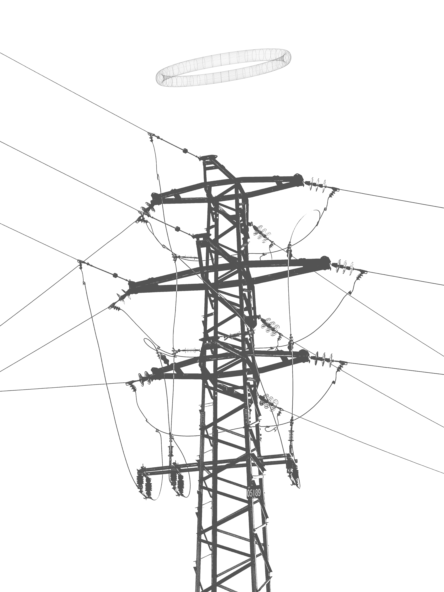
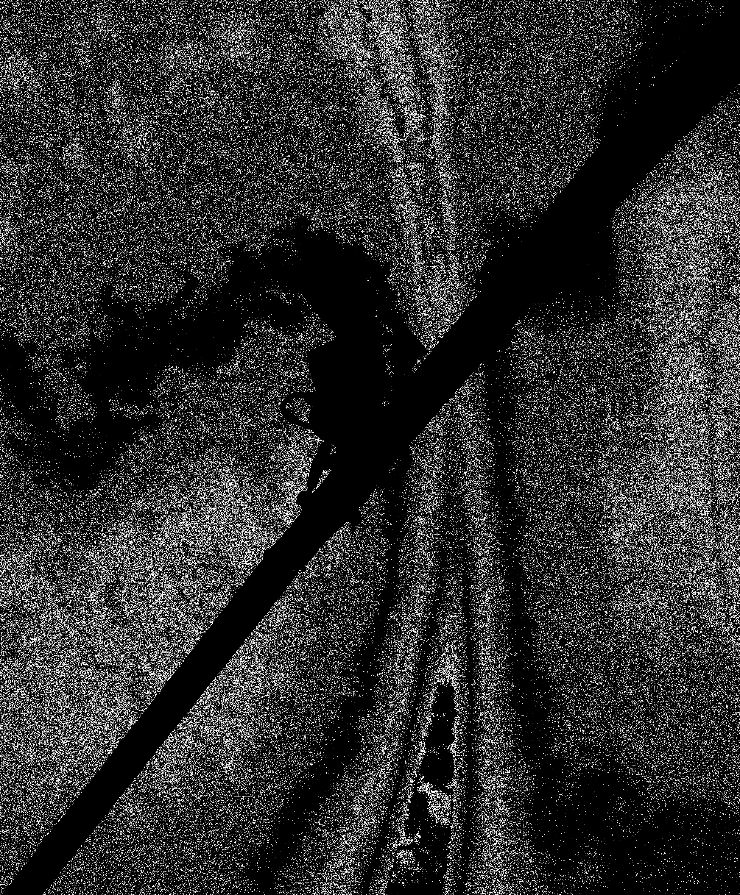

# Pic Utils

A local desktop laboratory for experimental image art: glitch, collage, double
exposure, channel surgery, and other unorthodox edits. Build parametric
pipelines from small Python **blocks**, run seeded batches of experiments,
curate the results, compose winners on a layered canvas, and export.

Pic Utils is a single-window app with two modes:

- **Lab** — sources → pipeline → parameters → preview → batch → curation.
- **Canvas** — layers, transforms, six blend modes, masks, groups, crop/resize,
  save/reopen, and PNG/JPEG/TIFF export.

Everything runs locally and offline on Python 3.12 with PySide6, numpy,
OpenCV, Pillow, scikit-image, and scikit-learn.

## Install and run

```bash
uv sync --extra dev
uv run pic-utils
```

`uv run python -m pic_utils` is equivalent. On first launch the app creates its
settings, a user-blocks folder with an example block, and a results folder.

## Documentation

- [User guide](docs/user-guide.md) — Lab and Canvas workflows, shortcuts,
  settings, file locations.
- [Block authoring](docs/block-authoring.md) — the decorator API, parameter
  annotations, masks, seeds, and hot reload.
- [Performance](docs/perf.md) — measured memory and preview latency.
- [Changelog](CHANGELOG.md) — release notes, including behavior changes from
  the legacy module.

## Development

Prerequisites: Python 3.12 and [uv](https://docs.astral.sh/uv/).

```bash
uv sync --extra dev
```

Layout: package code lives under `src/pic_utils/`, tests under `tests/`, and
design documents under `specs/`.

Quality gates:

```bash
uv run ruff check .
uv run ruff format --check .
uv run mypy src
uv run pytest -q
```

Long-running performance measurements are marked `slow`:

```bash
uv run pytest tests/perf -q -m slow
```

## Examples created with this software

<p align="center" style="display: flex; justify-content: center; gap: 10px;">
  
  
  
</p>

<p align="center">
  
</p>
<p align="center">
  
</p>
<p align="center">
  
</p>

## License

See [LICENSE](LICENSE).
