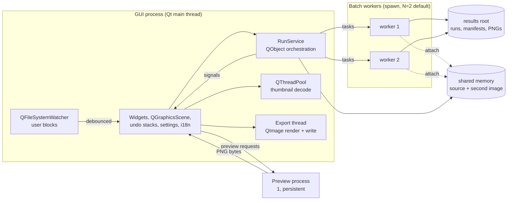
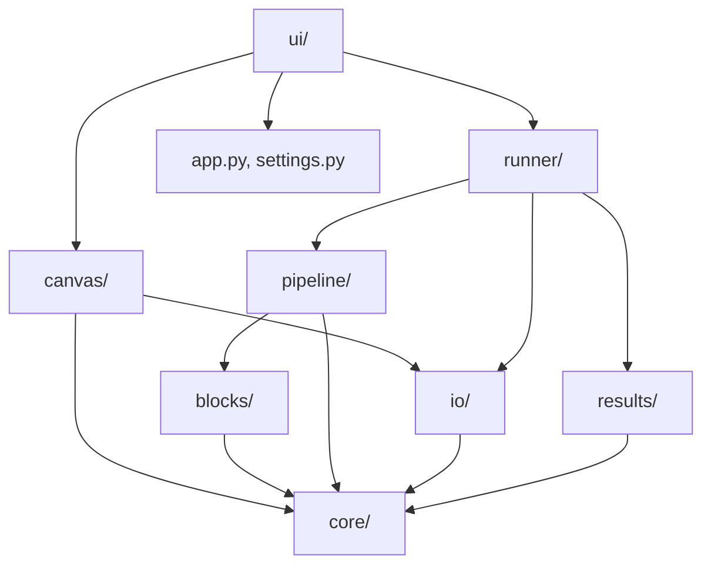
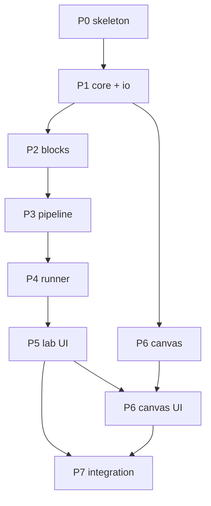

# Pic Utils — Architecture

**Version:** 1.0
**Status:** FINAL for v1 implementation planning (product interpretations flagged in §23)
**Date:** 2026-11-09
**Companions:**
- `specs/prd.md` — product requirements (binding)
- `specs/stack.md` — technology stack (binding)
- `specs/legacy-modernization.md` — core-library migration plan

**Audience:** implementers; agents that will turn this document into code.

**Normative language:** `MUST` / `SHOULD` / `MAY` per RFC 2119. Decision IDs
(`AD-nn`) are stable; never renumber. Every open question from PRD §15 is
resolved in Appendix A.

---

## 0. How to read this document

This is the **HOW**. It fixes:

1. The canonical data types and their invariants (§3).
2. The exact block, pipeline, runner, canvas, and persistence contracts
   (§5–§11, §17) — with signatures and schemas, so independent agents can
   implement against them.
3. The process/thread topology and the rules that keep the UI responsive
   and the 8 GB ceiling intact (§1.2, §8, §19).
4. The build order and task decomposition (§22).

Rules for implementers:

- `stack.md` is not negotiable. Do not add a web layer, a second language,
  Qt Designer/QML, or a compiled extension.
- If this document and the PRD disagree, the PRD wins; raise the conflict
  instead of silently choosing.
- If an implementation needs a contract change (signature, schema, error
  code), update this document in the same change. Contracts are the
  interface between agents.
- Every task ends with `uv run ruff check .`, `uv run ruff format --check .`,
  `uv run mypy src`, and `uv run pytest -q` green.

### 0.1 Decision register

| ID | Decision | Section |
|---|---|---|
| AD-01 | Canonical model: uint8 RGB + optional alpha plane; Mask uint8; RGB order; no premultiplied alpha in the model. | §3, §4 |
| AD-02 | Block API: decorated pure functions + `Annotated` param specs; output kinds `IMAGE`/`MASK`/`LAYERS`. | §5.1–5.3 |
| AD-03 | Registry: immutable name-keyed snapshots; per-file last-good reload; per-run frozen block copy; auto-watch. | §5.4–5.5 |
| AD-04 | Pipeline: linear image chain; masks as side inputs; bypass; `LAYERS` terminal. | §6 |
| AD-05 | Planning: grid/random/hybrid; deterministic seed derivation; batch-size semantics. | §7 |
| AD-06 | Execution: spawned process pool; shared-memory inputs; workers write results to disk. | §8.1–8.3, §8.8 |
| AD-07 | Failure policy: graceful cancel, force kill, watchdog timeout, pool rebuild. | §8.4–8.5 |
| AD-08 | Memory guard: psutil RSS, per-experiment estimate, defer/fail, pool rebuild on growth, 512 MB reserve. | §8.6, §19 |
| AD-09 | Results: run folders, `manifest.json` + `results.jsonl` + `curation.json`, atomic writes. | §9.1–9.2 |
| AD-10 | Curation/trash: state in `curation.json`, physical move, session lifecycle. | §9.3 |
| AD-11 | Canvas persistence: `CanvasDoc`, content-addressed assets, JSON + sibling folder. | §10.1–10.2, §10.8 |
| AD-12 | Canvas rendering: per-item Qt composition modes, shared transform helpers, proxy screen, full-res export. | §10.3–10.7 |
| AD-13 | Export: scopes, timestamped folder, PNG/JPEG/TIFF, sRGB, atomic per file. | §11 |
| AD-14 | Undo: `QUndoStack`, command classes, merge, limit 100. | §12 |
| AD-15 | i18n: `QTranslator`, `retranslate()` protocol, English block metadata. | §15 |
| AD-16 | Settings/paths: `QSettings` INI, typed wrapper, standard locations. | §16 |
| AD-17 | Persistence: `format` + `version`, explicit migrations, project/canvas/preset schemas. | §17 |
| AD-18 | UI: single window, stacked modes, models/views, strict threading rules. | §13 |
| AD-19 | Dependencies: pinned set, headless OpenCV, psutil. | §21.1 |
| AD-20 | Testing/CI: synthetic fixtures, pytest + pytest-qt, Linux + Windows matrix. | §20 |
| AD-21 | Errors/logging: typed hierarchy, stable codes, parent-written run log, diagnostics. | §18 |
| AD-22 | Preview: dedicated process, 1024 proxy, 150 ms debounce, latest-wins, restart on reload. | §14 |
| AD-23 | Packaging: uv + hatchling, `pic-utils` entry point, src layout. | §21.2–21.3 |

---

## 1. System overview

### 1.1 Context

Single-user desktop application, offline, two modes in one window:

- **Lab**: block library → pipeline → parameters → batch run → curation grid.
- **Canvas**: layered composition of accepted results → export.

Everything runs in one Python environment. There is no server, no database,
no network. State lives in JSON files, image files, and `QSettings`.

### 1.2 Process and thread topology



Hard rules:

- The **GUI thread** never runs image processing, file I/O larger than small
  JSON, or waits on a process. Everything long-running is off-thread.
- Batch work runs in **spawned processes** (`multiprocessing` context
  `"spawn"`), never `fork` (Qt and fork do not mix).
- The **preview** runs in its own persistent process so a crashing block
  cannot take down the UI and so previews never queue behind a batch.
- Workers write results **directly to disk**; the parent receives only small
  metadata records. No image ever crosses the process boundary except
  through shared memory (inputs) or PNG bytes (preview, small).
- `QImage`/`QPainter` work is allowed off the GUI thread; `QPixmap` is not.
  Export renders to `QImage` in a worker thread and converts only at the end.

### 1.3 Layering and dependency rules



- `core/` imports nothing from the application. It is pure Python + numpy +
  OpenCV primitives (no Pillow, no Qt).
- `io/` is the **only** module that knows file formats, EXIF, and channel
  order at the boundary.
- `blocks/` may import `core/`; it MUST NOT import `io/`, `ui/`, `runner/`,
  or `canvas/` (blocks are pure; no file I/O).
- `pipeline/` may import `blocks/` and `core/`; it MUST NOT import Qt or
  `io/`.
- `runner/` orchestrates `pipeline/`, `results/`, and `io/`; it may import Qt
  only in `service.py` (the QObject facade). Worker code MUST NOT import Qt.
- `canvas/` may import `core/`, `io/`, and Qt (scene, rendering).
- `ui/` may import everything. Nothing imports `ui/`.
- No import cycles. Enforced by review and, where practical, an import-linter
  test in CI (optional; not a v1 blocker).

### 1.4 Module map

```
src/pic_utils/
├── __init__.py
├── __main__.py             # python -m pic_utils
├── app.py                  # main(): spawn setup, QApplication, wiring
├── settings.py             # typed QSettings wrapper
├── logging_setup.py        # app log + per-run log helpers
├── core/
│   ├── image.py            # Image, Mask, Layer, BlendMode
│   ├── color.py            # hex colors, luminance, RGB<->BGR bridges
│   ├── stats.py            # find_channel_percentiles
│   ├── errors.py           # exception hierarchy + error codes
│   ├── jsonio.py           # atomic writes, jsonable(), read_json()
│   └── paths.py            # standard paths, content hashing, safe names
├── io/
│   ├── loader.py           # load_image(path) -> Image
│   ├── saver.py            # save_image(Image, path, options)
│   └── formats.py          # extension -> format, validation
├── blocks/
│   ├── api.py              # @block, param specs, OutputKind, BlockDef
│   ├── registry.py         # BlockRegistry, BlockSnapshot, reload
│   ├── userblocks.py       # user folder discovery/import
│   └── builtin/
│       ├── channels.py     # channel_permute, permutation_grid
│       ├── masks.py        # channel_mask, brightness_mask, color_range_mask
│       ├── compose.py      # overlay, double_exposure, conditional_overlay
│       └── segment.py      # segment
├── pipeline/
│   ├── model.py            # Pipeline, PipelineStep, (de)serialization
│   ├── validate.py         # Issue, validate_pipeline, validate_run_config
│   ├── execute.py          # execute_pipeline (pure, no Qt)
│   └── plan.py             # ExperimentSpec, build_plan
├── runner/
│   ├── protocol.py         # task/outcome dataclasses, event kinds
│   ├── shm.py              # SharedImageStore
│   ├── worker.py           # worker entrypoint (spawn-safe, no Qt)
│   ├── pool.py             # SupervisedPool
│   ├── memory.py           # MemoryGuard
│   ├── manifest.py         # RunStore, RunData, atomic writes
│   ├── preview.py          # preview process client/server
│   └── service.py          # RunService(QObject)
├── results/
│   ├── store.py            # run listing, accepted index
│   └── trash.py            # session trash lifecycle
├── canvas/
│   ├── model.py            # CanvasDoc, CanvasLayer, CanvasGroup
│   ├── assets.py           # content-addressed asset store
│   ├── scene.py            # QGraphicsScene, LayerItem, handles
│   ├── render.py           # shared layer transform/draw helpers
│   └── export.py           # full-resolution renderer + file writing
├── ui/
│   ├── main_window.py
│   ├── i18n.py             # LanguageManager, retranslate protocol
│   ├── theme.py
│   ├── lab/
│   │   ├── page.py          # Lab composition root (layout + panel wiring)
│   │   ├── block_library.py
│   │   ├── pipeline_editor.py
│   │   ├── parameter_panel.py
│   │   ├── preview_pane.py
│   │   ├── results_grid.py
│   │   ├── run_controls.py
│   │   ├── project_actions.py
│   │   └── commands.py
│   ├── canvas/
│   │   ├── page.py          # Canvas composition root
│   │   ├── canvas_view.py
│   │   ├── layer_list.py
│   │   ├── layer_properties.py
│   │   ├── asset_tray.py
│   │   ├── export_dialog.py
│   │   ├── actions.py       # save/load/export actions
│   │   └── commands.py
│   ├── widgets/
│   │   ├── param_widgets.py
│   │   ├── compare_view.py
│   │   ├── image_viewer.py
│   │   └── notifications.py
│   └── dialogs/
│       ├── settings_dialog.py
│       ├── relink_dialog.py
│       └── mask_dialog.py
└── resources/
    ├── i18n/pic_utils_es.ts
    ├── i18n/pic_utils_es.qm
    └── presets/*.json
```

Repo-root `scripts/i18n.py` wraps `pyside6-lupdate` / `pyside6-lrelease`
(§15). Tests live under `tests/` mirroring `src/` (§20).

---

## 2. Cross-cutting conventions

| Topic | Rule |
|---|---|
| Python | 3.12 only. No 3.13 syntax (`type` aliases are fine; PEP 695 generics are fine in 3.12). |
| Typing | New code fully annotated. `mypy` progressive: `core/`, `io/`, `blocks/`, `pipeline/`, `runner/` must be clean; `ui/` is checked but `# type: ignore[...]` is allowed for Qt stubs with a reason. |
| Dataclasses | `@dataclass(frozen=True, slots=True, eq=False)` for value types holding numpy arrays (avoid elementwise `__eq__`/unhashable `__hash__`). |
| Mappings | Frozen dataclasses with mapping fields store read-only `Mapping` views (`MappingProxyType` or a defensive copy); never mutate a contract object after construction. |
| Mutability | `Image`/`Mask` arrays are marked read-only (`setflags(write=False)`). Blocks that need to mutate must `copy()` first. |
| Paths | `pathlib.Path` everywhere. Never string-concatenate paths. |
| JSON | `core/jsonio.py`: `jsonable()` converts numpy scalars/arrays to Python types; `write_json_atomic()` writes temp + `os.replace`. |
| Time | UTC ISO-8601 for persisted timestamps; local time only in display strings. Run IDs use local time for human readability. |
| Randomness | `numpy.random.default_rng(seed)` or `random_state=seed`; never the global `np.random` state. |
| Logging | stdlib `logging`, module-level `logger = logging.getLogger(__name__)`. No `print()` in library code. |
| Errors | Raise typed exceptions from `core/errors.py`; never bare `Exception`. UI maps codes to translated messages. |
| No globals | Services are constructed in `app.py` and injected. No module-level mutable singletons except the registry instance owned by the app. |
| Threading | No blocking call in the GUI thread. No Qt object touched from a non-GUI thread except via signals/queued connections. |
| Pixel loops | Python-level loops over pixels are banned. Vectorized numpy/cv2 only. |

---

## 3. Canonical data model (AD-01)

### 3.1 `Image`

```python
# core/image.py
@dataclass(frozen=True, slots=True, eq=False)
class Image:
    rgb: np.ndarray                 # (H, W, 3) uint8, RGB, C-contiguous, read-only
    alpha: np.ndarray | None = None # (H, W) uint8, read-only; None = opaque

    def __post_init__(self) -> None: ...   # validate + normalize, no pixel scans

    @property
    def width(self) -> int: ...
    @property
    def height(self) -> int: ...
    @property
    def size(self) -> tuple[int, int]: ...          # (width, height)
    @property
    def nbytes(self) -> int: ...

    @classmethod
    def from_rgb(cls, arr: np.ndarray) -> Image: ...
    @classmethod
    def from_rgba(cls, arr: np.ndarray) -> Image: ...
    def to_rgba(self) -> np.ndarray: ...            # (H, W, 4) uint8
    def with_alpha(self, alpha: np.ndarray | None) -> Image: ...
    def copy(self) -> Image: ...
    def resized(self, width: int, height: int,
                interpolation: int = cv2.INTER_AREA) -> Image: ...
    def to_proxy(self, max_long_side: int) -> Image: ...
```

Invariants enforced in `__post_init__`:

- `rgb.dtype == uint8`, `rgb.ndim == 3`, `rgb.shape[2] == 3`.
- `alpha is None` or `alpha.dtype == uint8`, `alpha.shape == rgb.shape[:2]`.
- Both arrays C-contiguous (copy if not) and read-only.
- `H >= 1`, `W >= 1`.
- No pixel-value scans (too expensive at 48 MP).

Because the dataclass is frozen, `__post_init__` uses
`object.__setattr__` when it must replace a non-contiguous or wrong-dtype
array with a normalized copy. `Image` takes ownership of the arrays it is
given: construction marks them read-only, so callers MUST NOT reuse a
mutable buffer after wrapping it.

**Why uint8 RGB + optional alpha plane** (and not float32, not always-RGBA):

- 48 MP RGB = 144 MB; RGBA = 192 MB. The 8 GB ceiling and 32-experiment
  batches make the 33% difference material.
- cv2/skimage/sklearn operate on 3-channel uint8 natively; float32 is an
  *internal* choice inside a block, not a pipeline currency.
- Alpha is only meaningful at compositing boundaries (overlay transparency,
  canvas layers, PNG export). Keeping it as a separate plane lets blocks that
  don't care ignore it, and keeps the hot math 3-channel.
- Blocks MAY convert to float32 internally (`rgb.astype(np.float32) / 255`)
  and MUST return uint8.

**Alpha propagation rule (pipeline executor):** if a block returns an
`Image` with `alpha is None` while its chain input had alpha **and** the
output has the same `(H, W)`, the executor reattaches the input alpha.
A block that intentionally makes the result opaque returns an explicit
`alpha = np.full((H, W), 255, np.uint8)`. Blocks that change geometry MUST
return their own alpha. This prevents silent transparency loss in
pixel-wise chains.

### 3.2 `Mask`

```python
@dataclass(frozen=True, slots=True, eq=False)
class Mask:
    data: np.ndarray        # (H, W) uint8
    soft: bool = False      # False => values must be exactly {0, 255}
```

- `soft=False` masks are validated to contain only `0` and `255` (one
  vectorized pass, done by the executor's output validator, not on every
  construction).
- A mask is always the same `(H, W)` as the image it applies to. The executor
  enforces this for block outputs and mask bindings.

### 3.3 `Layer` (block output)

```python
@dataclass(frozen=True, slots=True, eq=False)
class Layer:
    image: Image
    mask: Mask | None = None
    name: str = ""
```

`Layer` is the unit returned by a `LAYERS` block: one image (possibly with
alpha) plus an optional mask in the same coordinates. It is **not** the
canvas layer type; see `CanvasLayer` (§10.1).

### 3.4 `BlendMode`

```python
class BlendMode(StrEnum):
    NORMAL = "normal"
    MULTIPLY = "multiply"
    SCREEN = "screen"
    OVERLAY = "overlay"
    ADD = "add"
    DIFFERENCE = "difference"
```

Exactly the six modes required by FR-CAN-04. The mapping to Qt lives in
`canvas/render.py` (§10.4).

### 3.5 Memory accounting

| Quantity | Formula | 48 MP value |
|---|---|---|
| RGB image | `H*W*3` | 144 MB |
| Alpha plane | `H*W` | 48 MB |
| RGBA image | `H*W*4` | 192 MB |
| Mask | `H*W` | 48 MB |
| Proxy image (long side 1024) | ≈ `1024*768*3` | ≈ 2.4 MB |
| Thumbnail (256 long side, PNG) | ≈ 256×192×4 | ≈ 0.2 MB |

These numbers drive the memory guard (§8.6) and the canvas export strategy
(§10.7).

---

## 4. I/O layer (AD-01)

### 4.1 API

```python
# io/loader.py
MAX_PIXELS = 48_000_000

def load_image(path: Path) -> Image:
    """Load PNG/JPEG/TIFF. Applies EXIF orientation, normalizes to RGB(A)."""

def probe_image(path: Path) -> ImageInfo:
    """Cheap metadata read (size, mode, format) without decoding pixels."""

@dataclass(frozen=True)
class ImageInfo:
    width: int
    height: int
    mode: str          # Pillow mode, e.g. "RGB", "RGBA", "I;16"
    format: str        # "PNG", "JPEG", "TIFF"
    has_alpha: bool

# io/saver.py
def save_image(image: Image, path: Path, *,
               jpeg_quality: int = 92,
               tiff_compression: str = "tiff_lzw",
               embed_srgb: bool = True) -> None:
    """Atomic write: temp file in the same directory + os.replace."""

def load_mask(path: Path) -> Mask:
    """Load an 8-bit grayscale PNG as a soft mask."""

def save_mask(mask: Mask, path: Path) -> None:
    """Atomic grayscale PNG write (used by the canvas mask generator)."""
```

### 4.2 Rules

| Input | Behavior |
|---|---|
| PNG / JPEG / TIFF | Supported (FR-IO-01). |
| Grayscale (L, LA, 1, I;1) | Replicate to RGB; alpha preserved if present. |
| Palette (P) | Convert to RGB(A). |
| CMYK | Convert to RGB via Pillow. |
| RGBA | Split into RGB + alpha plane. |
| 16-bit (`I;16`, `I;16B`, …) | **Reject** with `image.16bit` (FR-IO-02). No silent downconversion. |
| > 48,000,000 pixels | Raise `ImageTooLargeError` with dimensions. The UI catches it and offers an explicit "Load downscaled to 48 MP" action (FR-IO-04). |
| Corrupt/unreadable | Raise `ImageLoadError(path, reason)`. Batch callers skip and report (FR-IO-10). |
| EXIF orientation | Applied on load via `ImageOps.exif_transpose`; the orientation tag is not re-emitted on save (FR-IO-08). |
| ICC profile | Not color-managed. If a non-sRGB profile is present, log a warning and continue (working space is sRGB, §11 of PRD). |

Save rules:

- PNG: RGB or RGBA as-is; `compress_level=3` for results (speed), `6` for
  exports.
- JPEG: alpha flattened onto white; quality from settings (default 92).
- TIFF: LZW compression; RGB or RGBA.
- sRGB ICC profile embedded via `PIL.ImageCms.createProfile("sRGB")` for all
  three formats (FR-EXP-06). No profile asset is committed.
- Writes are atomic: encode to a temp file in the destination directory, then
  `os.replace`. A failed write never leaves a partial file (NFR-REL-03).

### 4.3 Channel-order boundary

RGB is canonical everywhere. cv2 uses BGR for color images. The only
sanctioned bridge:

```python
# core/color.py
def to_bgr(rgb: np.ndarray) -> np.ndarray: ...    # cvtColor RGB2BGR
def from_bgr(bgr: np.ndarray) -> np.ndarray: ...  # cvtColor BGR2RGB
```

Blocks that call cv2 color functions MUST convert explicitly and convert
back. Grayscale cv2 operations need no conversion. `io/` never leaks BGR:
it uses Pillow, not cv2, for decoding.

---

## 5. Block system (AD-02, AD-03)

### 5.1 Authoring contract

A block is a decorated, pure Python function:

```python
from typing import Annotated
import numpy as np
from pic_utils.blocks import block, OutputKind, IntRange, Choice
from pic_utils.core.image import Image, Mask

@block(
    name="channel_mask",
    category="masks",
    description="Keep pixels whose channel value falls inside a range.",
    output=OutputKind.MASK,
)
def channel_mask(
    image: Image,
    channel: Annotated[str, Choice(["R", "G", "B", "L"])] = "B",
    low: Annotated[int, IntRange(0, 255, step=1)] = 0,
    high: Annotated[int, IntRange(0, 255, step=1)] = 255,
    soft: bool = False,
    invert: bool = False,
) -> Mask:
    ...
```

Normative rules:

1. **One decorated function = one block.** `name` is the stable identity
   (FR-BLK-09). It must be unique across built-ins and user blocks.
2. **Parameters come from the signature** (FR-BLK-02). No JSON descriptor.
3. **Parameter kinds** (FR-BLK-03): `int` (`IntRange`), `float`
   (`FloatRange`), choice over `str`/`int`/`float` (`Choice`), `bool`,
   `str` + `Color`, `int | None` + `Seed`. Free text is not supported.
4. **Defaults are real defaults.** Every scalar parameter MUST have a default.
   UI ranges/steps live in the `Annotated` metadata, not in the default.
5. **Image inputs:** parameters annotated `Image`. The **first** in signature
   order is the chain input; every subsequent `Image` parameter is bound to
   the run's fixed second image (FR-BLK-07).
6. **Mask inputs:** parameters annotated `Mask` (required) or `Mask | None`
   (optional). Required mask inputs MUST be bound to an upstream mask output
   (FR-PIPE-02).
7. **Output kind** (FR-BLK-05): `IMAGE` → returns `Image`; `MASK` → returns
   `Mask`; `LAYERS` → returns `list[Layer]` (1..16 layers).
8. **Seeds:** stochastic blocks declare `Annotated[int | None, Seed()]`. The
   executor always injects a concrete `int`; blocks never see `None`
   (FR-BLK-11). Use `np.random.default_rng(seed)` or `random_state=seed`.
9. **No side effects:** no file I/O, no `print`, no plotting, no global RNG,
   no mutation of inputs, no network.
10. **No `*args` / `**kwargs`**, no positional-only parameters. Keyword-only
    parameters are allowed.
11. **Return type must match `output`.** Checked at registration when
    annotations are resolvable; checked at runtime by the executor.

### 5.2 Parameter metadata types

```python
# blocks/api.py
@dataclass(frozen=True)
class IntRange:
    min: int
    max: int
    step: int = 1
    unit: str = ""

@dataclass(frozen=True)
class FloatRange:
    min: float
    max: float
    step: float = 0.01
    log: bool = False
    unit: str = ""

@dataclass(frozen=True)
class Choice:
    options: tuple[str | int | float, ...]
    labels: tuple[str, ...] | None = None

@dataclass(frozen=True)
class Color:
    pass          # value is "#rrggbb"

@dataclass(frozen=True)
class Seed:
    pass          # value is int | None (None = derive per experiment)
```

Implicit kinds: `bool` needs no metadata; `Image` and `Mask` are inputs.

### 5.3 Introspection result

```python
class ParamKind(StrEnum):
    INT = "int"; FLOAT = "float"; CHOICE = "choice"; BOOL = "bool"
    COLOR = "color"; SEED = "seed"; IMAGE = "image"; MASK = "mask"

@dataclass(frozen=True)
class ParamDef:
    name: str
    kind: ParamKind
    annotation: object
    default: object | None
    required: bool
    spec: IntRange | FloatRange | Choice | Color | Seed | None

@dataclass(frozen=True)
class BlockDef:
    name: str
    category: str
    description: str
    output: OutputKind
    fn: Callable[..., object]
    params: tuple[ParamDef, ...]
    image_inputs: tuple[str, ...]     # first = chain
    mask_inputs: tuple[str, ...]
    api_version: int                  # BLOCK_API_VERSION = 1
    module: str
    source: Path | None               # None for built-ins
    content_hash: str                 # sha256 of source bytes, "" for built-ins
```

`BlockDef` is immutable. The UI derives controls from `params`; the executor
derives call arguments from `image_inputs`/`mask_inputs`.

### 5.4 Registry and snapshots

```python
# blocks/registry.py
class BlockSnapshot:
    defs: Mapping[str, BlockDef]      # immutable view
    hash: str                         # see below
    def get(self, name: str) -> BlockDef: ...

class BlockRegistry(QObject):
    changed = Signal(object)          # ReloadReport
    def snapshot(self) -> BlockSnapshot: ...
    def reload(self) -> ReloadReport: ...
```

- Built-ins are imported from `pic_utils.blocks.builtin` at startup.
- User blocks live in the configured folder (default
  `QStandardPaths.AppConfigLocation/blocks`).
- **Snapshots are immutable.** A run binds to the snapshot it started with,
  so editing or reloading blocks mid-run cannot change that run's behavior.
- `hash` is the sha256 over: the sorted built-in block defs
  `(name, content_hash, api_version)` plus the sorted
  `(relative_path, sha256)` of every user-block file in the snapshot. It is
  recorded in the run manifest; the per-run copy (§5.5) can reconstruct it.

### 5.5 User block loading and hot reload (AD-03)

Algorithm for `reload()`:

1. Take the registry lock.
2. Purge from `sys.modules` every module whose `__file__` is under the user
   blocks folder (including helper modules).
3. Import every top-level `*.py` in the folder except `__init__.py` and
   `_*.py` as module `pic_utils_userblocks.<stem>`, with the folder on
   `sys.path` (so helpers import naturally).
4. Collect registrations into a staging mapping. **Per-file last-good:** if a
   file fails to import (syntax error, import error), its previously
   registered blocks stay active and the error is reported; files that import
   successfully replace their own blocks.
5. Validate: duplicate names, shadowing a built-in, bad signature, bad
   return annotation. Invalid blocks are rejected with a `BlockLoadError`.
6. Swap the snapshot atomically and emit `changed(ReloadReport)`.
7. A block whose name already existed keeps its identity; pipelines
   referencing it keep working (FR-BLK-09). If its signature changed, the
   pipeline validator reports `param.missing` / `param.unknown` for that step.

The registry caches the **source bytes of the last successful import per
file**. The per-run copy is built from that cache, so a run is reproducible
even if a file on disk is currently broken.

`ReloadReport`: `loaded`, `updated`, `removed`, `errors`, `duration_ms`.

**File watch (confirmed preference):** auto-reload is **on** by default.
`QFileSystemWatcher` watches the blocks folder and its subdirectories; changes
are debounced 400 ms. On a syntax error the last good snapshot stays active
and a non-modal error is shown (deduplicated by message). A manual "Reload
blocks" action always exists (FR-UI-04). The setting
`runner/auto_reload_blocks` disables the watcher.

**Per-run freeze:** at run start, the user blocks folder is copied to
`<run_dir>/blocks/` and workers load blocks from that copy. This makes a run
immune to edits and reloads during execution, and makes the run's block code
archivable. The copy is small (`.py` files only).

### 5.6 Output validation (runtime)

After every block call the executor checks:

- `IMAGE`: `isinstance(out, Image)`; shape `(H, W, 3)` uint8; alpha shape
  matches; `H, W >= 1`.
- `MASK`: `isinstance(out, Mask)`; shape equals the chain input's `(H, W)`;
  if `soft=False`, values are exactly `{0, 255}`.
- `LAYERS`: `list`/`tuple` of `Layer`, length 1..16; each image non-empty;
  each mask matches its image.
- Any violation → `InvalidBlockOutput` → experiment fails with
  `block.invalid_output`; the batch continues (FR-BLK-10, NFR-REL-01).

### 5.7 Built-in catalog (v1)

All blocks are reimplemented against this contract; nothing is ported as-is
(PRD §7.12).

| Block | Inputs | Output | Parameters |
|---|---|---|---|
| `channel_permute` | image | image | `order: Choice(rgb, rbg, grb, gbr, brg, bgr)`, `invert_r/g/b: bool` |
| `permutation_grid` | image | layers (6–9) | `mode: Choice(channel_order, invert)`, `include_original: bool` |
| `overlay` | image + second | image | `x, y: IntRange(-4096, 4096)`, `z_order: Choice(over, under)`, `white_to_transparent: bool`, `resize_to_match: bool`, `opacity: FloatRange(0, 1)` |
| `double_exposure` | image + second | image | `exposure_factor: FloatRange(0, 2)`, `resize_to_match: bool` |
| `conditional_overlay` | image + second + mask | image | `threshold: IntRange(0,255)`, `r_low/r_high/g_low/g_high/b_low/b_high: IntRange(0,255)`, `strict: bool` |
| `segment` | image | layers (1..16) | `clusters: IntRange(2,16)`, `use_superpixels: bool`, `superpixel_count: IntRange(100,5000)`, `min_cluster_pixels: IntRange(0,1_000_000)`, `modular_recolor: bool`, `modulus: IntRange(2,256)`, `seed: Seed` |
| `channel_mask` | image | mask | `channel: Choice(R,G,B,L)`, `low/high: IntRange(0,255)`, `soft: bool`, `invert: bool` |
| `brightness_mask` | image | mask | `threshold: IntRange(0,255)`, `auto: bool`, `soft: bool`, `invert: bool` |
| `color_range_mask` | image | mask | `r_low/r_high/g_low/g_high/b_low/b_high: IntRange(0,255)`, `strict: bool`, `soft: bool`, `invert: bool` |

Implementation notes:

- `find_channel_percentiles` is a utility in `core/stats.py`, not a block
  (PRD §7.12 note). `brightness_mask(auto=True)` uses it on luminance.
- `overlay` fixes the legacy defects: `white_to_transparent` applies to the
  overlay image (not the background); size mismatch pads/crops instead of
  crashing; RGB/BGR is explicit.
- `double_exposure` with `resize_to_match=False` pads/crops to the first
  image's size and never raises a broadcast error.
- `segment` uses SLIC on Lab pixels (when superpixels are on) +
  MiniBatchKMeans with `random_state=seed`; superpixel means are computed
  with `np.bincount` (no Python loop over superpixels); each cluster becomes
  a `Layer` cropped to its bounding box with alpha outside the cluster.
  `modular_recolor` uses `default_rng(seed)` and guards `modulus == 0`.
- `permutation_grid` emits at most 8 layers, within the 16-layer cap.

**Interpretation to confirm:** `segment` emits **all** clusters (above
`min_cluster_pixels`) as separate layers/results; the PRD's "selected
clusters" parameter is replaced by curation (discard unwanted clusters in the
grid). This is a deliberate simplification enabled by terminal `LAYERS`
semantics; see §23.

---

## 6. Pipeline (AD-04)

### 6.1 Model

```python
@dataclass(frozen=True)
class PipelineStep:
    id: str                         # uuid4 hex, stable for the project's lifetime
    block: str                      # block name
    params: dict[str, Any]         # scalar params only; None = auto seed
    bypass: bool = False
    mask_bindings: dict[str, str] = field(default_factory=dict)  # param -> step id

@dataclass(frozen=True)
class Pipeline:
    steps: tuple[PipelineStep, ...]
```

Serialization is a plain dict (`{"steps": [...]}`) embedded in projects and
presets. Step ids are generated with `uuid.uuid4().hex` and never reused.

### 6.2 Execution semantics

`execute_pipeline()` is a pure function (no Qt, no I/O):

```python
# pipeline/execute.py
@dataclass(frozen=True)
class PipelineOutput:
    layers: tuple[Layer, ...]   # exactly 1 for image pipelines, 1..16 for LAYERS

def execute_pipeline(
    pipeline: Pipeline,
    snapshot: BlockSnapshot,
    source: Image,
    second: Image | None,
    experiment: ExperimentSpec,
) -> PipelineOutput:
    ...
```

Algorithm:

```
current = source
masks: dict[step_id, Mask] = {}
for step in pipeline.steps:
    if step.bypass: continue
    defn = snapshot.get(step.block)
    args = {}
    for p in defn.params:
        if p.kind is IMAGE:
            args[p.name] = current if p.name == defn.image_inputs[0] else second
        elif p.kind is MASK:
            src = step.mask_bindings.get(p.name)
            args[p.name] = masks[src] if src else None
        elif p.kind is SEED:
            args[p.name] = resolve_seed(experiment, step, p)
        else:
            args[p.name] = experiment.params[step.id].get(p.name, p.default)
    out = call_block(defn, args)          # exception -> ExperimentFailure
    validate_output(defn, out, current)   # -> InvalidBlockOutput
    if defn.output is IMAGE: current = propagate_alpha(out, current)
    elif defn.output is MASK: masks[step.id] = out
    elif defn.output is LAYERS: return PipelineOutput(layers=tuple(out))
return PipelineOutput(layers=(Layer(current),))
```

Rules:

- **Mask blocks do not advance the image chain.** They consume the current
  image and store their mask under their step id.
- **`LAYERS` must be the last step** (confirmed decision). Validation rejects
  any step after it. Each layer becomes one result.
- **The last non-bypassed step MUST produce an image.** A trailing mask block
  is a validation error (`step.trailing_mask`): a mask is only usable as a
  side input to a later block, or generated for a canvas layer via the mask
  dialog (§10.5). A pipeline with no image-producing step is invalid.
- **Bypass** passes the current image through unchanged; a bypassed step's
  mask output is unavailable, and any binding to it is a validation error.
- **Alpha propagation** per §3.1.

### 6.3 Validation and error taxonomy

```python
@dataclass(frozen=True)
class Issue:
    severity: Literal["error", "warning"]
    code: str
    message: str
    step_id: str | None = None
    param: str | None = None

def validate_pipeline(pipeline, snapshot, *, second_image_available,
                      sources_available) -> list[Issue]: ...
def validate_run_config(config, pipeline, snapshot) -> list[Issue]: ...
```

| Code | Severity | Meaning |
|---|---|---|
| `pipeline.empty` | error | No steps. |
| `step.unknown_block` | error | Block name not in the snapshot. |
| `step.duplicate_id` | error | Two steps share an id. |
| `step.layers_not_last` | error | A step follows a `LAYERS` block. |
| `step.trailing_mask` | error | The last step produces a mask; the pipeline yields no image. |
| `step.no_output` | error | Pipeline has no image-producing step. |
| `param.missing` | error | Required param has no value. |
| `param.unknown` | error | Stored param not in the block signature (reload drift). |
| `param.type` | error | Value type does not match the param kind. |
| `param.range` | error | Numeric value outside `IntRange`/`FloatRange`. |
| `param.choice` | error | Value not in `Choice.options`. |
| `mask.unbound` | error | Required `Mask` param has no binding. |
| `mask.forward_reference` | error | Binding points to a later step. |
| `mask.source_bypassed` | error | Binding points to a bypassed step. |
| `mask.type_mismatch` | error | Binding points to a non-mask block. |
| `image.second_missing` | error | Block needs a second image; none selected. |
| `block.api_version` | warning | Block written for a different API version. |
| `run.no_sampled` | error | Random mode with no sampled parameters. |
| `run.invalid_axis` | error | Axis references a missing step/param or an incompatible kind. |
| `run.too_many_experiments` | error | Plan exceeds 10,000 experiments. |
| `source.none` | error | No source images selected. |
| `source.unreadable` | warning | A source failed to load; it will be skipped. |

The UI shows issues inline on the affected step; the launch button is
disabled while any `error` exists.

---

## 7. Experiment planning (AD-05)

### 7.1 Model

```python
@dataclass(frozen=True)
class SweepAxis:
    step_id: str
    param: str
    values: tuple[Any, ...]

@dataclass(frozen=True)
class RunConfig:
    mode: Literal["grid", "random", "hybrid"]
    batch_size: int = 32              # random sample count
    random_samples: int = 0           # hybrid: samples per grid combination
    master_seed: int = 0
    axes: tuple[SweepAxis, ...] = ()
    sampled: tuple[tuple[str, str], ...] = ()   # (step_id, param)

@dataclass(frozen=True)
class ExperimentSpec:
    index: int
    source_index: int
    params: dict[str, dict[str, Any]]  # step_id -> param -> value
    seed: int
    label: str
```

### 7.2 Plan generation

```python
def build_plan(config: RunConfig, pipeline: Pipeline,
               snapshot: BlockSnapshot, source_count: int) -> list[ExperimentSpec]:
    ...
```

- **grid**: cartesian product of `axes.values` (the empty product is 1), for
  each selected source. Total = `product(axis lengths) × source_count`.
  `batch_size` is ignored (the UI displays the exact count). A grid with no
  axes is the "run the fixed pipeline on every source" case.
- **random**: `batch_size` sampled parameter sets, distributed round-robin
  across sources. Total = `batch_size`.
- **hybrid**: `product(axes) × random_samples` per source.
- **Sampled parameter distributions**:
  - `IntRange`: `rng.integers(min, max + 1)`, aligned to `step`.
  - `FloatRange`: `rng.uniform(min, max)`; if `log`, `exp(uniform(log min, log max))`;
    quantized to `step`.
  - `Choice`: `rng.choice(options)`.
  - `Bool`: `rng.integers(0, 2)`.
  - `Color`: random `#rrggbb` (uniform RGB).
  - `Seed`: never sampled; derived (below).
- Parameters not in an axis and not sampled keep the pipeline value.
- **Seed derivation** (stable across versions and platforms):

```python
def derive_seed(master: int, *parts: str | int) -> int:
    h = hashlib.blake2b(digest_size=8)
    h.update(master.to_bytes(8, "little"))
    for p in parts:
        h.update(str(p).encode("utf-8"))
    return int.from_bytes(h.digest(), "little") & 0x7FFFFFFF

experiment_seed = derive_seed(config.master_seed, "experiment", index)
step_seed       = derive_seed(experiment_seed, "step", step.id)
```

- A `Seed` param with an explicit value in the pipeline uses that value;
  `None` means "use the derived `step_seed`".
- The plan is generated once at launch and stored in the run manifest, so the
  exact experiment list is recorded even if the planner changes later.
- **Guard**: > 10,000 experiments is an error; > 2,000 shows a warning.
- **Disk preflight**: estimate `experiments × results_per_experiment × 30 MB`
  for 48 MP PNGs; warn if free space is below 2× the estimate.

---

## 8. Experiment runner (AD-06, AD-07, AD-08)

### 8.1 Why processes, not threads

| Requirement | Threads | Processes |
|---|---|---|
| A crashing block must not kill the app (G5) | A segfault in cv2 kills the app | Worker dies; parent recovers |
| Memory ceiling (G3) | Leaked memory is unreclaimable | Kill and recycle the worker |
| Cancel a hung block | Impossible | Kill the worker |
| GIL | numpy/cv2 release it, but Python-level block code does not | True parallelism |
| Cost | Cheap | Spawn + IPC (mitigated by shared memory and disk-written results) |

Decision: **spawned process pool**, default 2 workers, configurable 1–8
(FR-SET-05). The process pool is a robustness boundary, **not** a security
boundary (blocks are trusted local code, NFR-SEC-01).

### 8.2 Pool lifecycle

```python
# runner/pool.py
class SupervisedPool:
    def start(self, init: WorkerInit) -> None: ...
    def submit(self, task: ExperimentTask) -> Future[ExperimentOutcome]: ...
    def cancel_pending(self) -> None: ...          # graceful
    def kill_all(self) -> None: ...                # force
    def rebuild(self) -> None: ...                 # crash, timeout, or memory recycle
    def shutdown(self) -> None: ...

@dataclass(frozen=True)
class WorkerInit:
    event_queue: object            # multiprocessing.Queue (spawn context)
    blocks_dir: str                # <run_dir>/blocks
    run_dir: str
    block_snapshot_hash: str
    log_level: str
```

- `multiprocessing.get_context("spawn")` + `ProcessPoolExecutor`.
- `init_worker()` is a module-level function (spawn-safe):
  - records its PID in the event queue,
  - adds the run's copied blocks folder to `sys.path`,
  - builds a `BlockSnapshot` from built-ins + the copied user blocks and
    verifies its hash against the run's `block_snapshot_hash`; a mismatch
    fails every task with `block.snapshot_mismatch`,
  - routes log records through the event queue (the parent writes `run.log`).
- Each worker reports `started` events through a `multiprocessing.Queue`
  before executing an experiment, so the parent knows which experiment each
  PID is running.
- `app.py` calls `multiprocessing.set_start_method("spawn", force=True)`
  before creating `QApplication`.

### 8.3 Task and outcome

```python
# runner/protocol.py
@dataclass(frozen=True)
class ImageHandle:
    name: str                       # shared memory block name (RGB)
    shape: tuple[int, int, int]
    dtype: str = "uint8"
    alpha_name: str | None = None   # separate shared block for the alpha plane
    alpha_shape: tuple[int, int] | None = None

@dataclass(frozen=True)
class ExperimentTask:
    run_dir: str
    experiment: ExperimentSpec
    pipeline: dict                  # serialized Pipeline
    source: ImageHandle
    second: ImageHandle | None
    block_snapshot_hash: str

@dataclass(frozen=True)
class ResultFile:
    layer_index: int
    path: str                       # relative to run_dir
    thumb_path: str
    width: int
    height: int

@dataclass(frozen=True)
class ExperimentOutcome:
    experiment_index: int
    status: Literal["ok", "failed"]
    error_code: str | None
    error_message: str | None
    elapsed_ms: int
    results: tuple[ResultFile, ...]
```

`run_experiment(task)` (module level, in `worker.py`):

1. Attach the source/second shared memory, copy into private arrays, detach.
2. Build the pipeline + snapshot (cached per worker; rebuild if the hash
   differs).
3. `execute_pipeline(...)`.
4. Write each layer (one for image pipelines, N for `LAYERS`):
   - `results/result_{exp:04d}_{layer:02d}.png`
   - thumbnail → `thumbs/<same stem>.png` (long side 256, PNG to preserve alpha)
   - atomic writes.
5. Return `ExperimentOutcome` (small metadata only).

A worker never sends image data back.

### 8.4 Cancellation

- **Graceful cancel** (default): stop submitting; cancel queued futures;
  running experiments finish and their results are kept (FR-RUN-05). The run
  status becomes `cancelled`; the summary counts completed/failed/cancelled.
- **Force stop**: kill all worker PIDs via `psutil.Process.kill()`; in-flight
  experiments are marked `cancelled`; the pool is shut down and the run ends
  as `cancelled`. Results already written stay.
- The UI stays responsive throughout (FR-RUN-04, NFR-PERF-04).

### 8.5 Crash and timeout recovery

- If a worker dies (segfault, OOM kill, `os._exit`), pending futures raise
  `BrokenProcessPool`. `RunService`:
  1. marks the experiment(s) that were `started` on the dead PID as
     `worker.crashed`,
  2. shuts down the broken executor,
  3. rebuilds the pool,
  4. continues with the remaining experiments.
- Maximum 3 rebuilds per run; beyond that the run aborts with
  `pool.unstable`.
- **Watchdog**: an experiment running longer than
  `runner/experiment_timeout_s` (default 300 s) is killed, marked
  `block.timeout`, and the pool is rebuilt. This handles infinite loops.

### 8.6 Memory guard (AD-08)

```python
# runner/memory.py
class MemoryGuard:
    ceiling_mb: int                  # settings, default 8192
    def app_rss_mb(self) -> int: ...
    def worker_rss_mb(self) -> dict[int, int]: ...   # psutil, polled 500 ms
    def estimate_experiment_mb(self, source: Image, pipeline: Pipeline,
                               snapshot: BlockSnapshot) -> int: ...
    def can_dispatch(self, estimate_mb: int) -> bool: ...
```

- Estimate: `bytes_per_image = H*W*3`; `est = bytes_per_image *
  min(2 + 2 * image_steps, 8)`; for a `LAYERS` step use
  `bytes_per_image * 8`. At 48 MP this is ≈ 0.3–1.2 GB per experiment
  (1.15 GB for a 3+ step pipeline).
- Before dispatch: if `app_rss + sum(worker_rss) + est > ceiling`, wait for a
  worker to finish instead of dispatching. If `app_rss + est > ceiling`, fail
  the experiment immediately with `memory.limit`.
- A 512 MB reserve covers the preview process, Qt caches, and allocator
  overhead; the guard compares against `ceiling - 512 MB`.
- **Source shared memory counts against the ceiling.** All selected sources
  stay resident for the run (they are shared, not copied per worker). The
  preflight refuses a selection whose total source bytes + app RSS + worker
  reserve exceeds the ceiling, with a clear message asking the user to
  reduce the selection or the memory ceiling.
- Workers also check `psutil.virtual_memory().available` before starting and
  abort with `memory.limit` if it is below the estimate.
- **Recycling**: after each experiment, if a worker's RSS exceeds
  `ceiling / workers`, the pool is rebuilt between experiments. Killing a
  worker breaks `ProcessPoolExecutor`, so recycling is a rebuild, not a
  targeted kill. This bounds leaks and fragmentation.
- If the configured worker count cannot fit (`N * est + app > ceiling`), the
  service clamps `N` at runtime and logs a warning.
- The status bar shows live total RSS (FR-UI-01 guidance).

### 8.7 RunService

```python
# runner/service.py
@dataclass(frozen=True)
class RunRequest:
    pipeline: Pipeline
    snapshot: BlockSnapshot
    sources: tuple[Path, ...]
    second: Path | None
    run_config: RunConfig
    results_root: Path
    settings: Settings

@dataclass(frozen=True)
class RunSummary:
    run_id: str
    status: Literal["completed", "cancelled", "failed"]
    completed: int
    failed: int
    cancelled: int
    elapsed_ms: int

class RunService(QObject):
    run_started   = Signal(str, int)          # run_id, total experiments
    progress      = Signal(int, int)          # done, total
    result_ready  = Signal(object)            # ResultRecord
    run_finished  = Signal(object)            # RunSummary
    run_failed    = Signal(str, str)          # code, message
    memory_updated = Signal(int)              # total RSS MB

    def start(self, request: RunRequest) -> None: ...
    def cancel(self, force: bool = False) -> None: ...
    @property
    def is_running(self) -> bool: ...
```

Start sequence (runs on a dedicated thread; only signal emission touches the
GUI thread):

1. Validate (pipeline + run config + sources).
2. Create the run folder and `manifest.json` (status `running`).
3. Copy the cached user-block sources to `<run_dir>/blocks/`.
4. Load sources; create shared memory blocks; skip unreadable sources with a
   warning. If no source loads, fail the run with `source.none`.
5. Build the plan; write it to the manifest.
6. Start the pool and dispatch, respecting the memory guard.
7. On each outcome: append to `results.jsonl`, emit `result_ready` and
   `progress`.
8. On finish/cancel/failure: write the summary, set the run status, release
   shared memory, shut down the pool.

Futures are tracked with `add_done_callback`; callbacks emit Qt signals
(queued), so no GUI-thread future waiting is ever needed. The UI shows a
"Preparing…" state (sources loading, shared memory, plan) until
`run_started` fires. Only one run at a time; `start()` while running is a
programming error.

### 8.8 Shared memory

```python
# runner/shm.py
class SharedImageStore:
    def put(self, image: Image) -> ImageHandle: ...
    def release(self, handle: ImageHandle) -> None: ...
    def close(self) -> None: ...
```

- `multiprocessing.shared_memory.SharedMemory(create=True, size=nbytes)`.
- The parent copies the RGB array once (and the alpha plane into a second
  block when present); workers attach by name, copy into private arrays
  (needed because the block API exposes read-only arrays and detaching with
  live views is unsafe), then close the handles.
- Names: `picutils_{run_id}_{index}`.
- The parent keeps handles alive until the pool has shut down, then unlinks.
- Shared memory is the only large-data IPC. If creation fails, the run fails
  with a clear `shm.unavailable` error (no silent pickle fallback).

---

## 9. Results, curation, trash (AD-09, AD-10)

### 9.1 Run folder layout

```
<results_root>/
  <run_id>/                       # e.g. 20261109-143012-a1b2c3
    manifest.json                 # header, config, pipeline, sources, summary
    results.jsonl                 # append-only result records
    curation.json                 # {"result_id": "accepted"|"discarded"}
    results/
      result_0003_00.png
    thumbs/
      result_0003_00.png
    blocks/                       # copied user blocks for this run
    run.log
  trash/
    <session_id>/
      <run_id>/...
```

- `run_id = YYYYMMDD-HHMMSS-<6 hex>` (local time + random suffix) — unique
  and human-readable.
- Result id = `"{experiment:04d}:{layer:02d}"`.
- File names are predictable and collision-free within a run.
- `manifest.json` is written atomically at start and at the end. It is small
  (no per-result rows).
- `results.jsonl` is append-only, one JSON object per result, flushed after
  each write. This avoids O(n²) rewrites for runs with thousands of results.
- `curation.json` is rewritten atomically on each accept/discard (small).

### 9.2 Manifest schema

```json
{
  "format": "pic_utils.run",
  "version": 1,
  "run_id": "20261109-143012-a1b2c3",
  "created_at": "2026-11-09T14:30:12Z",
  "status": "running|completed|cancelled|failed",
  "app_version": "0.1.0",
  "block_api_version": 1,
  "block_snapshot_hash": "…",
  "pipeline": {"steps": [ … ]},
  "run_config": { … },
  "sources": [
    {"path": "/abs/or/relative.png", "width": 6000, "height": 4000}
  ],
  "second_image": {"path": "…", "width": 6000, "height": 4000},
  "experiments": [
    {"index": 0, "source_index": 0, "seed": 123456789,
     "params": {"step-id": {"param": "value"}}}
  ],
  "summary": {"completed": 30, "failed": 2, "cancelled": 0,
              "elapsed_ms": 184000}
}
```

`results.jsonl` line:

```json
{"id": "0003:00", "experiment": 3, "layer": 0, "source": 0,
 "kind": "image", "path": "results/result_0003_00.png",
 "thumb": "thumbs/result_0003_00.png", "width": 6000, "height": 4000,
 "seed": 987654321, "params": {"…": "…"}, "elapsed_ms": 812}
```

Failed experiments are **not** rows in `results.jsonl`; they are counted in
the summary and recorded in `run.log`. The grid shows results only.

```python
# runner/manifest.py
@dataclass(frozen=True)
class ResultRecord:
    id: str                 # "{experiment:04d}:{layer:02d}"
    experiment: int
    layer: int
    source: int
    kind: str               # "image"
    path: str               # relative to run_dir
    thumb: str              # relative to run_dir
    width: int
    height: int
    seed: int
    params: dict[str, dict[str, Any]]
    elapsed_ms: int
    accepted: bool | None = None   # None = pending; filled from curation.json

@dataclass(frozen=True)
class RunData:
    header: dict[str, Any]          # manifest.json
    results: tuple[ResultRecord, ...]
    curation: dict[str, str]        # result id -> "accepted" | "discarded"
```

### 9.3 Curation and trash

- Curation state lives in `curation.json`; missing = pending.
- **Accept**: set `accepted`; the result becomes available to the canvas
  asset tray (FR-RES-05).
- **Discard**: move the file (and thumb) to
  `<results_root>/trash/<session_id>/<run_id>/…`, then set `discarded`.
  Order matters: move first, then record. A crash between the two leaves an
  orphan file in trash, which is harmless.
- **Restore**: move back, then clear the state.
- The grid shows discarded results greyed out when "Show discarded" is on;
  restore is available (FR-RES-04, NFR-REL-02).
- **Session lifecycle**: a session id is generated at app start
  (`YYYYMMDD-HHMMSS-<pid>`). At startup, all trash directories except the
  current session's are deleted. On clean exit, the current session's trash
  is deleted. A crash leaves it for the next startup.
- Accepted results are indexed in memory (`results/store.py`) for the canvas
  tray; the index is refreshed on curation events and on demand.

### 9.4 Grid data flow

- `ResultsGridModel(QAbstractListModel)` exposes results as items with roles:
  `id`, `thumb_path`, `path`, `kind`, `accepted`, `seed`, `params`, `source`.
- Thumbnails are decoded off-thread (`QThreadPool` + `QRunnable`) and cached
  in an LRU (256 entries). The view is a `QListView` in `IconMode` with a
  custom delegate that draws the thumbnail and a status badge (pending /
  accepted / discarded).
- Keyboard: arrows navigate; `A` accept; `D` discard; `R` restore; `Space`
  A/B toggle; `Enter` full-resolution viewer.
- A/B compare: select two results → `CompareView` shows them side by side or
  toggles with `Space` (FR-RES-06).
- Selecting a result shows its seed and parameter values in a details strip
  below the grid (FR-RES-07).
- Full-resolution viewer: a dialog with pan/zoom, loading the full file on
  demand (FR-RES-08).

---

## 10. Canvas (AD-11, AD-12)

### 10.1 Document model

```python
@dataclass
class CanvasGroup:
    id: str
    name: str
    visible: bool = True
    opacity: float = 1.0

@dataclass
class CanvasLayer:
    id: str
    name: str
    image_ref: str                  # relative to the assets folder, e.g. <hash>.png
    x: float = 0.0                  # top-left, canvas coordinates
    y: float = 0.0
    scale: float = 1.0              # uniform
    rotation: float = 0.0           # degrees, about the image center
    flip_h: bool = False
    flip_v: bool = False
    opacity: float = 1.0
    blend: BlendMode = BlendMode.NORMAL
    mask_ref: str | None = None     # grayscale PNG asset
    group_id: str | None = None
    visible: bool = True
    locked: bool = False

@dataclass
class CanvasDoc:
    size: tuple[int, int]
    background: str | None = "#ffffff"   # None = transparent
    layers: list[CanvasLayer]            # index = z-order, last = top
    groups: dict[str, CanvasGroup]
    assets_dir: Path | None
    dirty: bool = False
```

- **One canvas open at a time** (FR-CAN-09).
- Layer order in the list is z-order (first = bottom). The layer list UI shows
  the reverse (top first), like every compositor.
- **Canvas size** (FR-CAN-08): initialized to the first placed layer's natural
  size; when a newly added layer's natural size exceeds the canvas, the canvas
  expands (content coordinates unchanged). Manual crop/resize sets the size
  explicitly; later additions still expand if larger. The canvas never
  auto-shrinks.
- Groups provide visibility, opacity, and membership. **Group opacity is
  applied per child** (measured Qt behavior, §10.4); group blend modes are
  not supported in v1. Group members are **contiguous** in the layer list;
  grouping a non-contiguous selection moves the members together at the
  topmost member's position.

### 10.2 Assets and canvas file

Confirmed decision: **JSON + sibling assets folder**.

```
my_collage.canvas                 # JSON, the commit point
my_collage.canvas.assets/
  <sha256[:16]>.png               # layer images
  <sha256[:16]>.mask.png          # grayscale masks
```

The assets folder is derived from the canvas file name
(`<stem>.canvas.assets/`). References inside the JSON are relative to that
folder, so the JSON is independent of the canvas filename; Save As renames
or copies both together.

- Assets are **content-addressed**: saving only adds new files; existing
  files are never invalidated. The JSON write is the atomic commit.
- Save protocol (runs on a worker thread with a progress indicator; the JSON
  commit happens in the GUI thread only if the document is unchanged during
  the copy):
  1. Copy/encode every referenced image and mask into the assets folder
     (skip if the content hash already exists).
  2. Write the JSON atomically (`temp` + `os.replace`).
  3. Best-effort garbage-collect unreferenced assets.
- Load: resolve asset paths relative to the canvas file; if any asset is
  missing, refuse to open and list the missing files (no partially restored
  canvas).
- Images are copied as PNG (lossless). Masks are stored as grayscale PNG.

```python
# canvas/assets.py
class AssetStore:
    def __init__(self, assets_dir: Path) -> None: ...
    def put_png_bytes(self, data: bytes) -> str: ...      # -> "<hash>.png"
    def put_image(self, image: Image) -> str: ...
    def put_mask(self, mask: Mask) -> str: ...            # -> "<hash>.mask.png"
    def resolve(self, ref: str) -> Path: ...              # raises if missing
    def gc(self, referenced: set[str]) -> None: ...       # best-effort
```

### 10.3 Scene mapping

| Model | Qt |
|---|---|
| Canvas size | `scene.setSceneRect(0, 0, w, h)` |
| Layer | `LayerItem(QGraphicsItem)` |
| Layer x/y | `item.setPos(x, y)` |
| Scale/rotation/flip | `item.setTransform(t)` where `t` is about the image center |
| Z-order | `item.setZValue(index)` |
| Opacity | `item.setOpacity(opacity)` |
| Blend mode | `painter.setCompositionMode(...)` inside `LayerItem.paint()` |
| Group | `QGraphicsItemGroup` (or a parent item) with children |
| Mask | baked into the item's `QImage` alpha (cache) |
| Background | `scene.drawBackground()` |

Transform construction (shared by scene and export):

```python
# canvas/render.py
# Qt post-multiplies: the FIRST call is the OUTERMOST transform (applied last
# to the point). Verified: translate(10) then scale(2) maps (1,0) -> (12,0).
def local_transform(layer: CanvasLayer, w: int, h: int) -> QTransform:
    """Rotation/scale/flip about the image center; no translation."""
    t = QTransform()
    t.translate(w / 2, h / 2)
    t.rotate(layer.rotation)
    t.scale(layer.scale * (-1 if layer.flip_h else 1),
            layer.scale * (-1 if layer.flip_v else 1))
    t.translate(-w / 2, -h / 2)
    return t

def layer_transform(layer: CanvasLayer, w: int, h: int) -> QTransform:
    """Full transform: translation is outermost, then the local transform."""
    t = QTransform()
    t.translate(layer.x, layer.y)          # outermost
    t.translate(w / 2, h / 2)
    t.rotate(layer.rotation)
    t.scale(layer.scale * (-1 if layer.flip_h else 1),
            layer.scale * (-1 if layer.flip_v else 1))
    t.translate(-w / 2, -h / 2)
    return t
```

`LayerItem` uses `local_transform` via `setTransform` and `setPos(x, y)`.
The export renderer uses `layer_transform` with `painter.setTransform(t)`.

### 10.4 Blend modes

```python
BLEND_TO_QT = {
    BlendMode.NORMAL:     QPainter.CompositionMode_SourceOver,
    BlendMode.MULTIPLY:   QPainter.CompositionMode_Multiply,
    BlendMode.SCREEN:     QPainter.CompositionMode_Screen,
    BlendMode.OVERLAY:    QPainter.CompositionMode_Overlay,
    BlendMode.ADD:        QPainter.CompositionMode_Plus,
    BlendMode.DIFFERENCE: QPainter.CompositionMode_Difference,
}
```

**Verified behavior** (spike run on PySide6 6.12, `QT_QPA_PLATFORM=offscreen`):

- Setting the composition mode inside `QGraphicsItem.paint()` blends the item
  against what is already painted, in z-order.
- The mode does not leak to subsequent items (a `SourceOver` item painted
  after a `Multiply` item renders normally).
- Item opacity composes with the mode (50% red `Multiply` over blue →
  `#000080`; over white → `#ff8080`).
- `scene.render()` honors the same modes, so screen and export share one
  model.
- `QGraphicsItemGroup` opacity is applied **per child**, not to a flattened
  group: two overlapping opaque red rects in a 50% group composite to
  `#ff4040` (75% red), not `#ff7f7f` (50% red).

Consequences:

- Keep the default **raster** viewport. Do not switch the view to
  `QOpenGLWidget`; composition-mode behavior is not guaranteed there.
- The canvas background is painted first (opaque white by default), so blend
  modes have a defined backdrop. A transparent background (`background:
  null`) is allowed and documented as producing transparent-backdrop blends.
- Group opacity multiplies each child's opacity. The export renderer does the
  same, so screen and export agree.

### 10.5 Masks

- A layer's effective alpha = image alpha × mask (per pixel).
- The masked image is built once per (layer, mask, resolution) and cached:
  `rgba = np.dstack([rgb, (alpha * mask // 255)])`, then
  `QImage(..., Format_RGBA8888)` converted to
  `Format_ARGB32_Premultiplied` for fast painting.
- **Mask generation for canvas layers** (FR-CAN-05): a "Generate mask…"
  dialog lets the user pick a mask block, edit its parameters, and run it on
  the selected layer's image. The result is stored as a grayscale PNG asset
  and applied to the layer. This satisfies "apply masks (channel/color/
  segmentation) to layers" without persisting pipeline intermediates.
- Masks are optional per layer and can be removed.

### 10.6 Interaction and undo

- Move: drag the item (`ItemIsMovable`); on release, push a
  `TransformLayerCommand` with the old/new x,y.
- Scale: corner handles (uniform); rotation: a handle above the item. Handles
  are child items with `ItemIgnoresTransformations` so they keep a constant
  screen size.
- Flip: context menu / properties (not a drag handle).
- Z-order: layer list drag-and-drop → `MoveLayerCommand`.
- Crop: rubber-band rectangle on the canvas → `CropCanvasCommand` (sets the
  size and offsets all layers by `-x, -y`).
- Resize: dialog → `ResizeCanvasCommand` (top-left anchored; layers are not
  scaled).
- Groups: create from selection, ungroup, add/remove members → commands.
- All mutations go through `QUndoStack` commands; the scene is a view of the
  model and is re-synced from the command's result.

### 10.7 Rendering: screen vs export

One renderer, two resolutions:

- **Screen**: layer images are decoded to a display proxy (long side ≤ 2048)
  and cached as `QPixmap` in the GUI thread. Zoom beyond 100% upscales the
  proxy; this is a documented v1 limitation.
- **Export**: `canvas/export.py` renders at full canvas resolution by
  iterating layers in z-order and drawing each one with the same
  `layer_transform` and blend mapping. It loads one full-res layer at a time
  (LRU size 2), applies the mask, draws, and releases. Peak memory ≈ target
  image + one layer + one mask (≈ 0.6 GB at 48 MP), not the sum of all
  layers.
- Group opacity is multiplied into each child's opacity, matching the screen.
- The export renderer is the **only** full-resolution compositor; the scene is
  never asked to hold all full-res layers.

```python
# canvas/export.py
def render_canvas(doc: CanvasDoc, *, scale: float = 1.0) -> QImage:
    """Full-resolution composite; QImage painting is thread-safe."""

def export_canvas(doc: CanvasDoc, target_dir: Path, *,
                  fmt: Literal["png", "jpeg", "tiff"],
                  jpeg_quality: int = 92,
                  scope: Literal["canvas", "canvas_and_accepted", "everything"],
                  accepted: Sequence[Path] = (),
                  run_results: Sequence[Path] = ()) -> ExportReport:
    """Render + write the export folder atomically per file."""
```

### 10.8 Canvas file schema

```json
{
  "format": "pic_utils.canvas",
  "version": 1,
  "size": [6000, 4000],
  "background": "#ffffff",
  "groups": [
    {"id": "g1", "name": "Group 1", "visible": true, "opacity": 0.8}
  ],
  "layers": [
    {
      "id": "l1",
      "name": "result_0001",
      "image": "3f2a9c1d4e5f6071.png",
      "x": 120.0, "y": -40.0,
      "scale": 1.2, "rotation": -8.0,
      "flip_h": false, "flip_v": false,
      "opacity": 0.85,
      "blend": "screen",
      "mask": "9c1d2e3f4a5b6c7d.mask.png",
      "group": null,
      "visible": true,
      "locked": false
    }
  ]
}
```

---

## 11. Export (AD-13)

### 11.1 Scope

The user chooses one scope per export (FR-EXP-02):

| Scope | Contents |
|---|---|
| `canvas` | The rendered canvas only. |
| `canvas_and_accepted` | Canvas + every accepted result of the current session. |
| `everything` | Canvas + every non-discarded result of the **current run** (pending and accepted; trash excluded). |

**Interpretation to confirm:** "everything" means the current run, not the
entire results root. This keeps the operation bounded and predictable.

### 11.2 Output layout and naming

```
<parent>/export_YYYYMMDD-HHMMSS/
  canvas.png | canvas.jpg | canvas.tiff
  results/
    result_0003_00.png
    …
  manifest.json            # scope, format, quality, file list, timestamp
```

- Collision-safe: if the folder exists, append `-2`, `-3`, ….
- The canvas is exported at full resolution (FR-EXP-03).
- Results are copied/transcoded to the chosen format; JPEG flattens alpha
  onto white.
- Naming is predictable and documented (FR-EXP-05).

### 11.3 Formats and metadata

- PNG, JPEG, TIFF (FR-EXP-01).
- JPEG quality from settings (default 92) (FR-EXP-04).
- TIFF: LZW.
- sRGB ICC profile embedded in every exported file (FR-EXP-06).
- Export is atomic per file (temp + replace); a failure never leaves a
  partial image.

### 11.4 Threading

- Canvas render + file writes run in a dedicated `QThread` with a worker
  object (`QImage` painting is thread-safe; `QPixmap` is not used).
- Progress is reported per file; the UI stays responsive.
- An unwritable target is reported without losing the canvas state (PRD §10).

---

## 12. Undo/redo (AD-14)

- Qt's `QUndoStack`, one per mode (Lab and Canvas), each with
  `setUndoLimit(100)` (FR-UNDO-05). The limit is configurable.
- Commands are small classes in the module that owns the model
  (`ui/lab/commands.py`, `ui/canvas/commands.py`).

Lab commands:

- `AddStepCommand`, `RemoveStepCommand`, `MoveStepCommand`,
  `BypassStepCommand`, `SetParamCommand`, `SetMaskBindingCommand`,
  `LoadPipelineCommand` (clears the stack).

Canvas commands:

- `AddLayerCommand`, `RemoveLayerCommand`, `MoveLayerCommand`,
  `TransformLayerCommand`, `SetLayerPropertyCommand`, `ApplyMaskCommand`,
  `CropCanvasCommand`, `ResizeCanvasCommand`, `GroupCommand`,
  `UngroupCommand`.

Rules:

- Slider/spinbox drags merge into one undo step: commands implement
  `id()` and `mergeWith()` keyed by `(step_id, param)` or `(layer_id,
  property)`.
- Transform drags push on mouse release, not on every mouse move.
- Not undoable (FR-UNDO-04): result accept/discard, project/canvas
  load/save, run launch.
- Loading a project or canvas clears the relevant stack.

---

## 13. UI architecture (AD-18)

### 13.1 Shell

- `MainWindow` with a top bar: mode switch (`Lab | Canvas`), run controls
  (Lab), export/save (Canvas), progress bar, and a menu bar.
- Main area is a `QStackedWidget` with the Lab and Canvas pages.
- Lab layout (splitters): left block library; center pipeline editor + preview
  pane; right parameter panel; bottom results grid.
- Run controls include the source list (add/remove, per-source checkboxes) and
  the second-image selector. The results panel has a run selector (current
  run by default) and a "Show discarded" toggle.
- Canvas layout: left asset tray; center canvas view; right layer list +
  layer properties.
- Status bar: memory usage, run status (Lab), canvas dimensions (Canvas), and
  transient notifications.
- Drag-and-drop on the main window: image files/folders add sources; project
  and canvas files open.

### 13.2 Models and views

| UI | Model | Notes |
|---|---|---|
| Block library | `BlockLibraryModel(QAbstractListModel)` + `QSortFilterProxyModel` | Categories + search; examples section. |
| Pipeline editor | `PipelineModel(QAbstractListModel)` | Rows = steps; drag-reorder; validity icons. |
| Parameter panel | `ParameterForm` (dynamic widgets) | Built from `BlockDef.params`. |
| Results grid | `ResultsGridModel(QAbstractListModel)` | `QListView` IconMode + delegate. |
| Layer list | `LayerListModel(QAbstractListModel)` | Reverse z-order display; drag-reorder. |
| Canvas | `QGraphicsScene` + `LayerItem` | Scene is a view of `CanvasDoc`. |

### 13.3 Threading rules in the UI

- All widgets, models, `QPixmap`, and `QGraphicsScene` objects live in the
  GUI thread.
- `RunService`, `PreviewService`, and the export thread communicate only via
  signals with queued connections.
- Thumbnail and layer-image decoding uses `QThreadPool`; the decoded
  `QImage` is converted to `QPixmap` in the GUI thread.
- No `time.sleep`, no `.result()` on futures, no `wait()` in the GUI thread.

### 13.4 Parameter widgets

`ui/widgets/param_widgets.py` maps `ParamDef` → widget:

| Kind | Widget |
|---|---|
| `INT` | `QSlider` + `QSpinBox` (synced), range/step from `IntRange` |
| `FLOAT` | `QDoubleSpinBox` + slider (mapped), step from `FloatRange` |
| `CHOICE` | `QComboBox` (labels if provided) |
| `BOOL` | `QCheckBox` |
| `COLOR` | Color swatch button → `QColorDialog` |
| `SEED` | `QSpinBox` + "auto" checkbox + randomize button |
| `MASK` | `QComboBox` of upstream mask steps (or "unbound") |

Every widget emits `edited(value)`; the panel pushes a `SetParamCommand`.
The panel also hosts the per-parameter "vary" control (fixed / sweep / sample)
that edits the `RunConfig`, not the pipeline.

### 13.5 Preview pane

- Shows the selected source (or the first source) with the pipeline applied
  at proxy resolution.
- Shows a spinner while rendering and a readable error on failure.
- A "Preview" toggle disables automatic previews for large images.

### 13.6 Notifications and dialogs

- Non-modal errors: a toast/status-bar message with a "Details" action that
  opens the log.
- Modal dialogs only for decisions: unsaved changes, relink, export, settings,
  mask generation.
- Block reload errors are non-modal and deduplicated.

---

## 14. Preview service (AD-22)

```python
# runner/preview.py (or ui/lab/preview_pane.py + a small process wrapper)
@dataclass(frozen=True)
class PreviewRequest:
    generation: int
    pipeline: dict
    snapshot_dir: str | None      # live user blocks folder
    source_path: str
    second_path: str | None
    proxy_long_side: int
    seed: int
```

- A single persistent process, spawned at app start (or lazily on first use).
  `runner/preview.py` holds the Qt-free process server and client;
  `ui/lab/preview_pane.py` adapts the client to Qt signals.
- Requests go through a `multiprocessing.Queue`; a reader thread in the GUI
  process blocks on the response queue and emits a Qt signal (queued) with
  `(generation, png_bytes, elapsed_ms)` or an error. The GUI thread never
  waits on the process.
- Loads the source, downscales to the proxy (long side 1024 by default),
  caches the decoded source and proxy by `(path, mtime)`.
- Executes the pipeline with `pipeline.execute.execute_pipeline` and returns
  PNG bytes + elapsed time. The parent decodes to `QImage`. For a `LAYERS`
  pipeline the preview shows the first layer and a "N layers" badge; the
  grid is the place to inspect all of them.
- **Debounce** 150 ms after any pipeline/param/source change; **latest wins**:
  a newer request supersedes a queued one, and stale generations are dropped.
- **Restart on block reload** (the process loads the live blocks folder) and
  on crash. A preview crash never affects the UI or a batch.
- Preview seed is fixed (`derive_seed(0, "preview")`) unless the user fixed a
  seed, so re-renders are stable.
- Target latency < 200 ms at 1024 px (NFR-PERF-05 recommendation).

---

## 15. Internationalization (AD-15)

- Qt's translation system: `QTranslator` + `.ts` sources + compiled `.qm`.
- All UI strings use `self.tr(...)` (context = class name) or
  `QCoreApplication.translate(...)`.
- **`retranslate()` protocol:** every widget class implements
  `retranslate()` that sets all user-visible strings. It is called at
  construction and whenever `LanguageManager.language_changed` fires.
  Models emit `dataChanged`/`layoutChanged` so item views refresh.
- `LanguageManager` loads `resources/i18n/pic_utils_<lang>.qm` via
  `importlib.resources`, installs/removes translators, and emits the signal.
  Switching language requires no restart (AC-12).
- Plurals use Qt's `%n` form: `self.tr("%n result(s)", "", n)`.
- Catalogs: `pyside6-lupdate` scans `src/`; `pyside6-lrelease` compiles.
  A `scripts/i18n.py` wrapper runs both. `.ts` and `.qm` are committed.
- **Block metadata** (names, categories, descriptions, parameter labels) is
  English-only in v1. Built-in category labels are translated in the UI via a
  fixed mapping; user categories are shown verbatim.
- Error codes are internal; the UI maps them to translated messages. Worker
  error detail (traceback) stays English and is shown under "Details".

---

## 16. Settings and paths (AD-16)

`QSettings` in INI format at `QStandardPaths.AppConfigLocation/settings.ini`,
wrapped by a typed `Settings` class with validation.

| Key | Default | Notes |
|---|---|---|
| `ui/language` | `system` | `system`, `en`, `es` |
| `ui/theme` | `system` | `system`, `light`, `dark` |
| `paths/blocks_folder` | `AppConfigLocation/blocks` | Created on first run with an example block. |
| `paths/results_root` | `PicturesLocation/PicUtils` | Fallback: `AppDataLocation/results`. |
| `paths/trash_root` | `<results_root>/trash` | |
| `runner/workers` | `2` | 1–8, clamped by memory. |
| `runner/memory_ceiling_mb` | `8192` | 512–8192 (FR-SET-04). |
| `runner/experiment_timeout_s` | `300` | Watchdog. |
| `runner/auto_reload_blocks` | `true` | Confirmed preference. |
| `preview/proxy_long_side` | `1024` | |
| `preview/debounce_ms` | `150` | |
| `export/jpeg_quality` | `92` | 1–100. |
| `export/tiff_compression` | `tiff_lzw` | |
| `undo/limit` | `100` | |
| `logging/level` | `INFO` | |

- Settings changes that affect a running service (workers, ceiling) apply to
  the next run and show a note.
- Paths are created on demand; failures are reported, not fatal.

**Standard locations**

| Purpose | Location |
|---|---|
| Settings | `QStandardPaths.AppConfigLocation` |
| Logs | `QStandardPaths.AppDataLocation/logs/app.log` (rotating, 5 MB × 3) |
| User blocks | `QStandardPaths.AppConfigLocation/blocks` |
| User presets | `QStandardPaths.AppDataLocation/presets/{pipelines,params}/` |
| Results | `QStandardPaths.PicturesLocation/PicUtils` |
| Trash | `<results_root>/trash` |

---

## 17. Persistence formats and versioning (AD-17)

Every persisted JSON document has `format` and `version` (FR-PERS-06).

### 17.1 Project file

```json
{
  "format": "pic_utils.project",
  "version": 1,
  "planner_version": 1,
  "app_version": "0.1.0",
  "sources": ["images/la_imagen.png"],
  "second_image": "images/second.png",
  "pipeline": {
    "steps": [
      {"id": "b1", "block": "channel_mask",
       "params": {"channel": "B", "low": 0, "high": 120, "soft": false, "invert": false},
       "bypass": false, "mask_bindings": {}},
      {"id": "b2", "block": "conditional_overlay",
       "params": {"threshold": 128, "r_low": 0, "r_high": 255,
                  "g_low": 0, "g_high": 255, "b_low": 0, "b_high": 200,
                  "strict": false},
       "bypass": false, "mask_bindings": {"mask": "b1"}}
    ]
  },
  "run": {
    "mode": "hybrid",
    "batch_size": 32,
    "random_samples": 2,
    "master_seed": 8347,
    "axes": [{"step_id": "b2", "param": "threshold", "values": [96, 128, 160]}],
    "sampled": [{"step_id": "b1", "param": "low"}]
  }
}
```

- Paths: relative to the project file when inside its directory, otherwise
  absolute. On load, missing files trigger the relink dialog (FR-PERS-05).
- The project embeds the full pipeline (self-contained); presets are a
  separate library, not references.
- **Does not contain canvas state** (FR-PERS-02) or results.

### 17.2 Preset files

```json
{"format": "pic_utils.preset", "version": 1, "kind": "pipeline",
 "name": "Double exposure", "pipeline": {"steps": [ … ]}}
```

- `kind: "pipeline"` → `presets/pipelines/<name>.json`.
- `kind: "params"` → `presets/params/<block>/<name>.json` with `"block"` and
  `"params"`.
- Shipped examples: read-only `resources/presets/*.json`, surfaced under
  "Examples" in the block library.

### 17.3 Migration policy

- Loaders dispatch on `format` and `version`.
- A newer version than the app supports → refuse with a clear error; never
  silently drop fields.
- Migrations are explicit functions (`migrate_v1_to_v2`) with tests.
- Unknown fields are preserved on load and re-emitted on save where feasible
  (forward compatibility for additive changes).

---

## 18. Errors, logging, diagnostics (AD-21)

### 18.1 Exception hierarchy

```python
# core/errors.py
class PicUtilsError(Exception): ...
class ValidationError(PicUtilsError): issues: list[Issue]
class BlockError(PicUtilsError): block: str; step_id: str | None
class InvalidBlockOutput(BlockError): ...
class ImageLoadError(PicUtilsError): path: Path; reason: str
class ImageTooLargeError(ImageLoadError): width: int; height: int
class UnsupportedImageError(ImageLoadError): ...
class MemoryLimitError(PicUtilsError): ...
class ExportError(PicUtilsError): ...
class CanvasFileError(PicUtilsError): ...
class ProjectFileError(PicUtilsError): ...
class RunError(PicUtilsError): code: str
```

### 18.2 Runtime error codes

| Code | Where | Behavior |
|---|---|---|
| `block.raised` | worker | Experiment failed; traceback in `run.log`; batch continues. |
| `block.invalid_output` | worker | Same. |
| `block.snapshot_mismatch` | worker init | Worker block code differs from the run snapshot; tasks fail. |
| `block.timeout` | watchdog | Worker killed; experiment failed; pool rebuilt. |
| `block.too_many_outputs` | worker | > 16 layers; experiment failed. |
| `memory.limit` | guard | Experiment failed or deferred. |
| `worker.crashed` | service | In-flight experiment failed; pool rebuilt. |
| `pool.unstable` | service | Run aborted after 3 rebuilds. |
| `shm.unavailable` | service | Run aborted; no fallback. |
| `io.read` / `io.write` | worker | Experiment failed; batch continues. |
| `cancelled` | service | User cancelled. |

### 18.3 Logging

- App log: rotating file at `AppDataLocation/logs/app.log`, level from
  settings.
- Run log: `<run_dir>/run.log`, written by the parent. Workers send log
  records and tracebacks through the event queue, so there is a single
  writer and no cross-process interleaving.
- Worker tracebacks: full traceback to the run log; a one-line message in the
  outcome.
- No telemetry, no network.
- A "Copy diagnostics" action in the Help menu collects app version, OS,
  Python/dependency versions, settings (redacted paths optional), and the
  tail of the app log.

---

## 19. Performance and memory (AD-08, AD-12)

### 19.1 Budgets

| Scenario | Budget |
|---|---|
| App idle (no images) | < 400 MB RSS |
| One 48 MP source + proxy + thumbnails | < 1 GB RSS |
| 2 workers × 48 MP experiment | ≈ 2.4 GB |
| Default batch (32 × 48 MP) | < 8 GB total (NFR-PERF-02/03) |
| Preview at 1024 px | < 200 ms target |
| Grid scroll with 500 thumbs | 60 fps (thumbnails decode off-thread) |

### 19.2 Rules

- Full-resolution processing only for batches and export. Preview and screen
  use proxies.
- Results are streamed to disk; never accumulate result images in RAM.
- Free intermediates promptly: `del` large arrays, avoid caching inside
  blocks, avoid per-cluster full-image copies (segment uses bounding-box
  crops).
- Use `cv2.INTER_AREA` for downscaling; `INTER_LINEAR` for upscaling.
- Avoid `np.ascontiguousarray` unless required; prefer views.
- No Python loops over pixels or superpixels (legacy-modernization Step 6).
- Thumbnails are generated in the worker from the in-memory result, not by
  re-reading the PNG.
- Canvas export loads one full-res layer at a time.
- Profile before optimizing: `cProfile` a synthetic 48 MP pipeline; document
  the top three hotspots in the PR that changes them.

### 19.3 Disk

- Results are PNG (lossless) with `compress_level=3`.
- A 48 MP result is ≈ 20–40 MB; a 32-experiment run ≈ 1 GB. The preflight
  warns when free space is insufficient.
- Canvas assets are content-addressed; saving repeatedly does not duplicate
  files.

---

## 20. Testing and CI (AD-20)

### 20.1 Layers

| Layer | What | Tools |
|---|---|---|
| Unit | `core`, `io`, `blocks`, `pipeline`, `runner` internals, `canvas` model/render | pytest |
| Integration | Runner end-to-end with fake/built-in blocks; crash/timeout/cancel; manifest; trash | pytest, `multiprocessing` |
| UI smoke | Window construction, language switch, parameter widgets, grid curation, canvas add/transform/save/load/render | pytest-qt, offscreen |
| Performance | 48 MP synthetic pipeline under the memory ceiling | pytest `slow` marker, psutil |

### 20.2 Fixtures and determinism

- **No binary fixtures in git.** Synthetic images are generated in code
  (`tests/fixtures.py`): gradients, checkerboards, noise with fixed seeds,
  small (8×8 … 256×256) and a `slow` 48 MP synthetic.
- Deterministic blocks: assert exact arrays or invariants computed
  independently in the test.
- Stochastic blocks: same seed → identical output; different seed →
  (usually) different output.
- Golden files are avoided; when unavoidable, keep them < 10 KB and justify.

### 20.3 Required tests per area

- `core/image`: invariants, alpha propagation, resize/proxy, read-only.
- `io`: PNG/JPEG/TIFF round-trip, grayscale, alpha, EXIF, 16-bit rejection,
  too-large rejection, corrupt file, atomic save.
- `blocks/api`: introspection of all param kinds, invalid signatures
  rejected, return-type checks.
- `blocks/registry`: built-ins load, user blocks load, reload diff, duplicate
  names, syntax error keeps that file's last good blocks, helper module
  reload.
- `blocks/builtin`: each block's shape/dtype/range/determinism/boundary
  cases (empty mask, full mask, zero modulus, size mismatch).
- `pipeline`: serialization round-trip, every validation code, mask binding
  rules, bypass, LAYERS terminal, alpha propagation, seed derivation.
- `plan`: grid/random/hybrid counts, determinism, distributions within
  bounds, 10k guard.
- `runner`: manifest/results.jsonl/curation atomicity, cancel keeps results,
  raising block, invalid output, worker crash recovery, timeout, memory
  guard estimate, shared memory lifecycle.
- `canvas`: transform math, blend mapping, mask application, save/load
  round-trip, content-addressed assets, full-res render pixel checks, group
  opacity semantics.
- `ui`: main window builds; language switch retranslates; parameter form
  generates the right widgets; accept/discard updates the manifest; canvas
  add/transform/save/load.

### 20.4 CI

GitHub Actions, matrix `ubuntu-latest` + `windows-latest`, Python 3.12:

```
uv sync --extra dev
uv run ruff check .
uv run ruff format --check .
uv run mypy src
uv run pytest -q          # QT_QPA_PLATFORM=offscreen
```

- `slow` tests run on a nightly job, not on every PR (unless the PR touches
  the runner/canvas renderer).
- Windows CI is mandatory (NFR-COMPAT-01); spawn, shared memory, and path
  handling are the usual breakage points.

---

## 21. Dependencies and packaging (AD-19, AD-23)

### 21.1 Runtime dependencies

| Package | Constraint | Why |
|---|---|---|
| `numpy` | `>=2.0,<3` | Canonical arrays; 2.x ABI. |
| `opencv-python-headless` | `>=4.13,<5` | Fast primitives; **headless** avoids bundling its own Qt (plugin conflicts with PySide6). OpenCV 5 is a major migration; out of scope for v1. |
| `pillow` | `>=11,<14` | Format I/O, EXIF, ICC. |
| `scikit-image` | `>=0.25,<0.27` | SLIC superpixels, region algorithms. |
| `scikit-learn` | `>=1.5,<2` | MiniBatchKMeans. |
| `pyside6` | `>=6.8,<7` | Qt 6 UI, QGraphicsScene. |
| `psutil` | `>=6,<8` | Cross-platform RSS for the memory guard (NFR-PERF-02). |

Dev extras: `pytest`, `pytest-qt`, `ruff`, `mypy`, `matplotlib` (dev only;
never imported by runtime code).

`ml` extra: reserved for future heavy libraries (torch, diffusion models);
empty in v1.

### 21.2 `pyproject.toml` skeleton

```toml
[project]
name = "pic-utils"
version = "0.1.0"
description = "A laboratory for experimental image art"
requires-python = ">=3.12,<3.13"
dependencies = [
  "numpy>=2.0,<3",
  "opencv-python-headless>=4.13,<5",
  "pillow>=11,<14",
  "scikit-image>=0.25,<0.27",
  "scikit-learn>=1.5,<2",
  "pyside6>=6.8,<7",
  "psutil>=6,<8",
]

[project.optional-dependencies]
dev = ["pytest>=8", "pytest-qt>=4.4", "ruff>=0.6", "mypy>=1.11", "matplotlib>=3.9"]
ml = []

[project.scripts]
pic-utils = "pic_utils.app:main"

[build-system]
requires = ["hatchling"]
build-backend = "hatchling.build"

[tool.hatch.build.targets.wheel]
packages = ["src/pic_utils"]

[tool.ruff]
line-length = 100
target-version = "py312"

[tool.ruff.lint]
select = ["E", "F", "I", "UP", "B", "SIM", "RUF"]

[tool.mypy]
python_version = "3.12"
warn_unused_ignores = true
warn_redundant_casts = true
no_implicit_optional = true
check_untyped_defs = true

[tool.pytest.ini_options]
testpaths = ["tests"]
addopts = "-q"
markers = ["slow: long-running performance tests", "gui: requires Qt"]
```

### 21.3 Entry point

```python
# app.py
def main() -> int:
    multiprocessing.set_start_method("spawn", force=True)
    app = QApplication(sys.argv)
    settings = Settings()
    setup_logging(settings)
    language = LanguageManager(app, settings)
    registry = BlockRegistry(settings.blocks_folder)
    registry.reload()
    window = MainWindow(settings, registry, language)
    window.show()
    return app.exec()
```

- `if __name__ == "__main__": raise SystemExit(main())` in a `__main__.py`
  for `python -m pic_utils`.
- No `freeze_support()` needed (no frozen builds), but harmless to include.
- Install/run: `uv sync`, `uv run pic-utils` (stack §6).

### 21.4 Repository hygiene

- `examples/*.png` (~116 MB) are committed legacy assets. Moving them out of
  git history is a **destructive** operation and requires explicit owner
  approval; it is not part of the build plan. New large binaries MUST NOT be
  committed (stack §6).
- No `setup.py`, no `requirements.txt`; `uv.lock` is committed.

---

## 22. Build plan (agent tasks)

Each task is independently reviewable and ends with the quality gates.
Tasks MUST NOT start before their dependencies are merged.

> **Execution source of truth:** `specs/implementation-plan.md` refines this
> list into eight phases with branch ownership, review protocol, and
> acceptance gates. It adds three execution tasks: **P5-10** (Lab
> composition), **P6-07** (Canvas composition), and **P7-05** (release gate).
> When this section and the implementation plan differ on ordering or
> ownership, the implementation plan wins; on contracts, this document wins.

### 22.1 Task graph



### 22.2 Tasks

**P0 — Foundation**

| ID | Task | Deliverables | Acceptance |
|---|---|---|---|
| P0-01 | Package skeleton and tooling | `pyproject.toml`, `src/pic_utils/__init__.py`, `tests/`, CI workflow, README dev section | `uv sync --extra dev`; ruff/mypy/pytest pass; CI green on Linux+Windows |
| P0-02 | Legacy quarantine | `src/pic_utils/legacy.py` (no matplotlib import, no `plt.show`), deprecation note | `import pic_utils.legacy` works without matplotlib; no plotting in `src/` |
| P0-03 | Core utilities | `core/errors.py`, `core/paths.py`, `core/jsonio.py`, `logging_setup.py` | Atomic-write test, `jsonable()` test, error hierarchy test |

**P1 — Core types and I/O**

| ID | Task | Deliverables | Acceptance |
|---|---|---|---|
| P1-01 | `core/image.py` | `Image`, `Mask`, `Layer`, `BlendMode`, validation, resize/proxy | Invariant tests; alpha propagation; read-only enforcement |
| P1-02 | Color and stats | `core/color.py`, `core/stats.py` | Hex parsing, luminance, BGR bridges, percentiles vs a reference implementation |
| P1-03 | Loader/saver | `io/loader.py`, `io/saver.py`, `io/formats.py` | Round-trip PNG/JPEG/TIFF; EXIF; grayscale; alpha; 16-bit and >48 MP errors; atomic save |
| P1-04 | I/O tests | `tests/io/` | All §20.3 I/O cases |

**P2 — Block system**

| ID | Task | Deliverables | Acceptance |
|---|---|---|---|
| P2-01 | Block API | `blocks/api.py` | All param kinds introspected; invalid signatures rejected; return-type checks |
| P2-02 | Registry and reload | `blocks/registry.py`, `blocks/userblocks.py` | Built-ins + user load; reload diff; duplicates rejected; syntax error keeps that file's last good blocks; helper reload |
| P2-03 | Channel blocks | `blocks/builtin/channels.py` | `channel_permute`, `permutation_grid` tests (determinism, layer count) |
| P2-04 | Mask blocks | `blocks/builtin/masks.py` | Three mask blocks; soft/binary; auto threshold; boundary cases |
| P2-05 | Compose blocks | `blocks/builtin/compose.py` | Overlay/double exposure/conditional overlay; size mismatch fixed; white→transparent on overlay |
| P2-06 | Segment block | `blocks/builtin/segment.py` | SLIC + KMeans; vectorized means; seeded; bounded layers; no divide-by-zero |
| P2-07 | Block tests | `tests/blocks/` | Per-block shape/dtype/range/determinism tests |

**P3 — Pipeline**

| ID | Task | Deliverables | Acceptance |
|---|---|---|---|
| P3-01 | Pipeline model | `pipeline/model.py` | Round-trip serialization; stable step ids |
| P3-02 | Validation | `pipeline/validate.py` | Every code in §6.3 has a test |
| P3-03 | Executor | `pipeline/execute.py` | Chain/mask/bypass/LAYERS-terminal; alpha propagation; seed injection; error capture |
| P3-04 | Planner | `pipeline/plan.py` | Grid/random/hybrid counts; seeded determinism; 10k guard; per-source distribution |
| P3-05 | Pipeline tests | `tests/pipeline/` | §20.3 pipeline cases |

**P4 — Runner**

| ID | Task | Deliverables | Acceptance |
|---|---|---|---|
| P4-01 | Run store and trash | `runner/manifest.py`, `results/store.py`, `results/trash.py` | Atomic manifest, append-only results, curation, trash move/restore, session cleanup |
| P4-02 | Shared memory and protocol | `runner/shm.py`, `runner/protocol.py` | Put/attach/release round-trip; names unique; cleanup |
| P4-03 | Worker | `runner/worker.py` | Executes a task, writes results + thumbs, returns outcome; no Qt import |
| P4-04 | Pool and memory guard | `runner/pool.py`, `runner/memory.py` | Crash recovery, timeout kill, pool rebuild on RSS growth, estimate, clamp |
| P4-05 | Run service | `runner/service.py` | Start/progress/result/finish/cancel; one run at a time; shared memory lifecycle |
| P4-06 | Runner integration tests | `tests/runner/` | Cancel keeps results; raising block; invalid output; crash recovery; timeout; manifest consistency |

**P5 — Lab UI**

| ID | Task | Deliverables | Acceptance |
|---|---|---|---|
| P5-01 | App shell | `app.py`, `settings.py`, `ui/theme.py`, `ui/i18n.py`, `ui/main_window.py`, `ui/dialogs/settings_dialog.py` | App launches; mode switch; language switch without restart; settings persist |
| P5-02 | Block library | `ui/lab/block_library.py` + watcher wiring | Search/categories; reload action; auto-reload; errors non-modal |
| P5-03 | Pipeline editor | `ui/lab/pipeline_editor.py` + commands | Add/remove/reorder/bypass; validation display; undo/redo |
| P5-04 | Parameter panel | `ui/lab/parameter_panel.py`, `ui/widgets/param_widgets.py` | All kinds; mask binding combo; seed auto; vary controls; undo merge |
| P5-05 | Preview | `runner/preview.py` + `ui/lab/preview_pane.py` | Debounce, latest-wins, proxy, error display, restart on reload |
| P5-06 | Results grid | `ui/lab/results_grid.py`, `ui/widgets/compare_view.py`, `image_viewer.py` | Thumbnails lazy; accept/discard/restore; shortcuts; A/B; full-res viewer |
| P5-07 | Run controls | `ui/lab/run_controls.py` | Sources, second image, mode, batch size, seed, plan count, launch/cancel, summary, memory |
| P5-08 | Project and presets | `ui/lab/project_actions.py`, `resources/presets/*.json` | Save/load project; relink; presets; four shipped examples |
| P5-09 | UI tests | `tests/ui/` | §20.3 UI cases |

**P6 — Canvas**

| ID | Task | Deliverables | Acceptance |
|---|---|---|---|
| P6-01 | Canvas model and assets | `canvas/model.py`, `canvas/assets.py` | Doc model; content-addressed store; save/load round-trip; missing-asset error |
| P6-02 | Scene and screen renderer | `canvas/scene.py`, `canvas/render.py` | Items, transforms, blend modes, masks, groups; interaction; undo commands |
| P6-03 | Full-res export renderer | `canvas/export.py` | Pixel-parity with screen at 1:1; bounded memory; group opacity semantics |
| P6-04 | Canvas UI | `ui/canvas/canvas_view.py`, `layer_list.py`, `layer_properties.py`, `asset_tray.py`, `dialogs/mask_dialog.py` | Add layers; transform; z-order; opacity/blend; mask; crop/resize; groups; shortcuts |
| P6-05 | Canvas save/load/export UI | `ui/canvas/export_dialog.py` + save actions | Save/reopen; export scopes/formats; ICC; collision-safe naming |
| P6-06 | Canvas tests | `tests/canvas/` | Transform math; blend pixel checks; save/load; export |

**P7 — Integration**

| ID | Task | Deliverables | Acceptance |
|---|---|---|---|
| P7-01 | End-to-end acceptance | `tests/e2e/` | AC-01…AC-12 covered or explicitly waived with a reason |
| P7-02 | Documentation | `docs/user-guide.md`, `docs/block-authoring.md`, README | Block authoring guide matches the API; user journey documented |
| P7-03 | Performance validation | `tests/perf/` (slow) | 48 MP batch under 8 GB; preview < 200 ms on the dev machine; report numbers |
| P7-04 | Packaging polish | entry point, `uv tool install` check, clean-venv run | `uv run pic-utils` works from a clean clone |

### 22.3 Agent task template

> **Read first:** `specs/architecture.md` (this file), the task row, and the
> files it touches. **Do:** implement exactly the deliverables; add the
> specified tests; keep the contracts in §3–§17 unchanged unless the task
> says otherwise. **Do not:** add dependencies, change the stack, introduce
> Qt Designer/QML, run pixel loops, block the GUI thread, or edit files owned
> by other tasks. **Finish:** `uv run ruff check . && uv run ruff format
> --check . && uv run mypy src && uv run pytest -q`; report the commands and
> results.

---

## 23. Decisions taken and PRD interpretations to confirm

The following were decided during architecture work. Items marked
**confirm** are product-visible interpretations of the PRD; everything else
is a technical decision within the stack.

| # | Decision | Status |
|---|---|---|
| 1 | `LAYERS` blocks are terminal; each layer becomes a result. | **Confirmed by owner** |
| 2 | Canvas file = JSON + sibling content-addressed assets folder. | **Confirmed by owner** |
| 3 | Block auto-reload is on by default (debounced, last-good on error). | **Confirmed by owner** |
| 4 | `segment` emits all clusters; selection happens in curation. | **Confirm** |
| 5 | Canvas auto-expands on larger layers, never auto-shrinks; crop/resize is explicit. | **Confirm** |
| 6 | `batch_size` governs random sampling; grid runs use the full product (shown in the UI). | **Confirm** |
| 7 | "Everything" export = current run + canvas (not all historical runs). | **Confirm** |
| 8 | Multi-source batches: total experiments = parameter sets × selected sources. | **Confirm** |
| 9 | Group opacity is per child (measured Qt behavior); group blend modes unsupported. | **Confirm** |
| 10 | Canvas background defaults to opaque white; transparent is opt-in. | **Confirm** |
| 11 | Canvas masks are generated on demand from mask blocks, not persisted from pipeline intermediates. | **Confirm** |
| 12 | 16-bit inputs are rejected, not downconverted. | Technical |
| 13 | >48 MP images are refused with an offer to downscale. | Technical |
| 14 | Results are PNG; thumbnails are PNG (alpha-safe). | Technical |
| 15 | `results.jsonl` + `curation.json` instead of rewriting a large manifest. | Technical |
| 16 | OpenCV pinned to 4.x (5.x is a major migration). | Technical |
| 17 | `opencv-python-headless` to avoid Qt plugin conflicts. | Technical |
| 18 | Preview runs in a dedicated process; restarts on reload/crash. | Technical |
| 19 | Per-run copied user blocks for reproducibility. | Technical |
| 20 | Undo limit 100, configurable. | Technical |

---

## 24. Deferred (explicitly out of v1)

- Autosave/recovery snapshots (FR-PERS-07).
- Re-run a result / use as a starting point (FR-RES-09).
- CLI batch mode.
- macOS.
- Installers/packaged binaries.
- GPU acceleration.
- Group blend modes and flattened group opacity.
- 16-bit pipeline, RAW, video, text layers, hand-painted masks (PRD §12).
- Plugin registry/marketplace.
- Full color management beyond sRGB.

---

## Appendix A — PRD §15 open questions resolved

| # | PRD question | Resolution |
|---|---|---|
| 1 | Canonical image representation | AD-01: uint8 RGB (H,W,3) + optional alpha plane; Mask uint8 (H,W); RGB order; no premultiplied alpha in the model. |
| 2 | Block signature and decorator API | AD-02: `@block(...)` + `Annotated` param specs; defaults are real defaults; first `Image` = chain, extras = second image; `Mask` params are bindings. |
| 3 | Multi-output blocks as layers | AD-04: `LAYERS` is terminal; each layer is a result. |
| 4 | Registry identity and hot reload | AD-03: name-keyed immutable snapshots; per-run frozen copy; purge-and-reimport reload; auto-watch. |
| 5 | Pipeline validation and error taxonomy | §6.3 (issue codes) + §18 (runtime codes). |
| 6 | Project/canvas schemas and versioning | §17, §10.8; `format` + `version` + explicit migrations. |
| 7 | Result naming, run ids, manifest | §9: timestamped run ids, predictable result names, manifest + results.jsonl + curation.json. |
| 8 | Preview strategy | AD-22: dedicated process, 1024 proxy, 150 ms debounce, latest-wins, restart on reload. |
| 9 | Threading/process model and cancellation | AD-06/07: spawn pool, graceful cancel, force kill, watchdog. |
| 10 | Memory guard | AD-08: psutil RSS, per-experiment estimate, defer/fail, pool rebuild on RSS growth. |
| 11 | Trash lifecycle | AD-10: session-scoped trash, move-then-record, cleanup at startup/exit. |
| 12 | i18n framework and catalogs | AD-15: Qt `QTranslator`, `.ts`/`.qm`, `retranslate()` protocol, English block metadata. |
| 13 | Reload manual vs file watch | AD-03: auto-watch on by default + manual action (confirmed). |
| 14 | Export naming and metadata | AD-13: `export_<timestamp>/`, scope, format, ICC sRGB, manifest. |
| 15 | Undo depth and storage | AD-14: `QUndoStack`, limit 100, commands with merge. |

---

## Appendix B — Requirement traceability

| PRD area | Modules | Tasks |
|---|---|---|
| FR-IO-01…10 | `io/`, `core/image.py` | P1-01…P1-04 |
| FR-BLK-01…14 | `blocks/` | P2-01…P2-07 |
| FR-PIPE-01…09 | `pipeline/` | P3-01…P3-05 |
| FR-RUN-01…10 | `runner/`, `pipeline/plan.py` | P3-04, P4-01…P4-06 |
| FR-RES-01…09 | `runner/manifest.py`, `results/`, `ui/lab/results_grid.py` | P4-01, P5-06 |
| FR-CAN-01…13 | `canvas/`, `ui/canvas/` | P6-01…P6-06 |
| FR-PERS-01…07 | `pipeline/model.py`, `canvas/model.py`, `ui/lab/project_actions.py` | P3-01, P5-08, P6-01 |
| FR-EXP-01…06 | `canvas/export.py`, `io/saver.py`, `ui/canvas/export_dialog.py` | P6-03, P6-05 |
| FR-UNDO-01…05 | `ui/lab/commands.py`, `ui/canvas/commands.py` | P5-03, P6-02 |
| FR-UI-01…08 | `ui/` | P5-01…P5-09 |
| FR-SET-01…05 | `settings.py`, `ui/dialogs/settings_dialog.py` | P5-01 |
| NFR-PERF-01…05 | `runner/memory.py`, proxies, thumbnails | P4-04, P7-03 |
| NFR-REL-01…03 | runner isolation, trash, atomic writes | P4, P6-01 |
| NFR-COMPAT-01 | CI matrix | P0-01 |
| NFR-USE-01 | `ui/i18n.py` | P5-01 |
| NFR-SEC-01 | trust model (no sandbox) | §8.1 |

---

## Appendix C — Block authoring guide (normative)

A complete user block:

```python
# ~/.config/pic_utils/blocks/my_blocks.py
from typing import Annotated

import numpy as np

from pic_utils.blocks import block, OutputKind, IntRange, Choice, Seed
from pic_utils.core.image import Image


@block(
    name="posterize",
    category="channels",
    description="Reduce each channel to N evenly spaced levels.",
    output=OutputKind.IMAGE,
)
def posterize(
    image: Image,
    levels: Annotated[int, IntRange(2, 32, step=1)] = 6,
    channel: Annotated[str, Choice(["all", "R", "G", "B"])] = "all",
    dither: bool = False,
    seed: Annotated[int | None, Seed()] = None,
) -> Image:
    rgb = image.rgb.astype(np.float32) / 255.0
    q = np.round(rgb * (levels - 1)) / (levels - 1)
    if channel != "all":
        idx = {"R": 0, "G": 1, "B": 2}[channel]
        q[..., idx] = rgb[..., idx]
    out = np.clip(q * 255.0, 0, 255).astype(np.uint8)
    if dither:
        noise = np.random.default_rng(seed).uniform(-0.5, 0.5, out.shape)
        out = np.clip(out.astype(np.float32) + noise, 0, 255).astype(np.uint8)
    return Image.from_rgb(out)
```

Rules recap:

1. One decorated function per block; unique `name`.
2. Scalar params have defaults; ranges via `Annotated`.
3. First `Image` is the chain input; extra `Image` params use the second image.
4. `Mask` params are bound to upstream mask blocks.
5. `Seed` params are `int | None`; the executor injects a concrete seed.
6. Return exactly the declared output type.
7. No I/O, no plotting, no global RNG, no input mutation.
8. Test with synthetic arrays; same seed must produce the same output.

Reload: save the file; the watcher reloads within ~0.5 s (or press "Reload
blocks"). Syntax errors keep the last good version and show a non-modal
error. A block whose signature changed is reported against any pipeline that
uses it.

---

## Appendix D — Glossary of internal terms

| Term | Meaning here |
|---|---|
| **Snapshot** | Immutable mapping of block name → `BlockDef` used by a run. |
| **Plan** | The concrete list of `ExperimentSpec` for a run. |
| **Outcome** | The small metadata record a worker returns. |
| **Display proxy** | Downscaled image used for preview and on-screen canvas. |
| **Asset** | Content-addressed PNG inside a canvas assets folder. |
| **Session** | One app launch; owns a trash subfolder. |
| **Vary control** | UI control marking a parameter as fixed / swept / sampled. |
