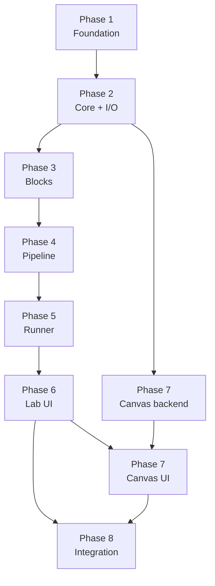

# Pic Utils — Implementation Plan

**Version:** 1.0
**Status:** ACTIVE — execution source of truth
**Date:** 2026-11-09
**Companions (read-only references):**
- `specs/prd.md` — product requirements (binding)
- `specs/stack.md` — technology stack (binding)
- `specs/architecture.md` — contracts and decisions (binding)
- `specs/legacy-modernization.md` — legacy migration notes

**Audience:** implementation agents, review agents, and the human integrator.

**Normative language:** `MUST` / `SHOULD` / `MAY` per RFC 2119.

---

## 0. How to use this document

This plan turns `specs/architecture.md` into **ordered, independently
reviewable tasks**. It does not redefine contracts. It defines:

1. The eight phases, their order, and their acceptance gates.
2. The exact task list per phase, with owned files and dependencies.
3. The branch, review, and merge protocol.
4. How an agent must behave while working on a task.
5. The evidence required to call a task or phase done.

### 0.1 Precedence

If documents disagree, stop and escalate. Do not silently choose.

```
specs/prd.md            product truth (what)
specs/stack.md          technology truth (with what)
specs/architecture.md   contract truth (how, interfaces, schemas)
specs/implementation-plan.md   execution truth (order, ownership, gates)
```

The implementation plan MAY add execution detail. It MUST NOT change a
signature, schema, error code, or decision from the architecture. A needed
change is a **contract-change task** (§3.3), not an improvisation.

### 0.2 Read order for every task

1. This document: the task row, its phase, §3 (ownership), §4 (protocol),
   §5 (review), §6 (DoD).
2. `specs/architecture.md`: the sections named in the task row.
3. `specs/prd.md`: the requirement IDs named in the task row.
4. `specs/stack.md`: confirm the tools and constraints.
5. The files you own and their existing tests.

### 0.3 What agents may edit

| File | Who may edit |
|---|---|
| `specs/prd.md`, `specs/stack.md`, `specs/architecture.md`, `specs/implementation-plan.md` | Human owner only. Agents read them. |
| Files listed in a task's **Owns** column | The task owner only. |
| `specs/status/<TASK-ID>.md` | The task owner and its reviewer. |
| `specs/status/phase-<N>.md` | The phase integrator only. |
| Everything else | Nobody, unless a contract-change task says so. |

If a task needs a file it does not own, it MUST stop and request a
contract-change task (§3.3). It MUST NOT "just fix it quickly".

### 0.4 Quick start for a task

```bash
# 1. Verify dependencies are merged
git switch main && git pull --ff-only
git log --oneline -5

# 2. Create the task branch
git switch -c task/<ID>-<slug>

# 3. Create the status file
cp specs/status/TEMPLATE.md specs/status/<ID>.md
# fill frontmatter: task, phase, title, status=in-progress, branch, owner, depends_on

# 4. Implement only the owned files, add tests
# 5. Run the gates
uv run ruff check .
uv run ruff format --check .
uv run mypy src
uv run pytest -q

# 6. Update status to review, open the PR
```

---

## 1. Operating model

### 1.1 Roles

| Role | Responsibility | Agent type |
|---|---|---|
| **Implementer** | Owns one task, one branch, one file set. Writes code and tests. | `task` |
| **Reviewer** | Reviews one PR against the task row and contracts. Does not edit. | `reviewer` |
| **Scout** | Read-only investigation when the relevant files are unknown. | `scout` |
| **Mechanical worker** | Strictly mechanical edits or data collection with exact instructions. | `sonic` |
| **Security reviewer** | Optional review of the runner/process/file-I/O boundary. | `security-reviewer` |
| **Phase integrator** | Human or a trusted `task` agent. Merges approved PRs, runs phase acceptance, writes the phase status, tags the phase. | `task` / human |
| **Human owner** | Resolves PRD ambiguity, approves contract changes and dependency additions, approves phase gates. | human |

One task = one implementer = one branch. One PR = one reviewer. The phase
integrator is the only role allowed to merge and tag.

### 1.2 Recommended omp session mode

**Use a normal interactive session with isolated `task` subagents — not vibe
mode — for this build.**

Why:

- The plan requires **parallel feature branches**. The `task` tool's
  `isolated: true` gives each implementer its own workspace and captures a
  branch/patch (`omp/task/<id>`), which is exactly the safe-branch model.
- The main session must run the **phase gates** (`uv`, `pytest`, `mypy`,
  `git`). Vibe mode reduces the director to `read` + worker-control tools, so
  it cannot run those gates itself; you would have to exit vibe for every
  gate.
- Vibe workers share the parent checkout. Running two vibe workers on
  overlapping files would collide. Vibe is a good fit for a **sequential**
  build or for delegating investigation, not for parallel branch work.

Use vibe mode only if you want a director that never edits or executes and
you accept sequential workers (one file set at a time). In that case, exit
vibe before each phase gate, or delegate the gate to a worker and read its
evidence.

### 1.3 Agent types by task kind

| Task kind | Agent | Effort |
|---|---|---|
| Core types, I/O, block API, registry, pipeline, runner, canvas renderer | `task` | `hi` |
| UI panels, dialogs, i18n, settings | `task` | `med` |
| Mechanical renames, fixture moves, data collection | `sonic` | `lo` |
| Read-only investigation before a task | `scout` | `med` |
| PR review | `reviewer` | `med` |
| Runner/process/file-I/O security review | `security-reviewer` | `med` |

Do not use `sonic` for design decisions or for anything that needs judgment.
Do not use `scout` for edits; it is read-only.

### 1.4 Isolation and branches (omp configuration)

Recommended project config (`.omp/config.yml`) or user config:

```yaml
tools:
  approvalMode: write          # main session: auto-approve read/write, prompt for exec

task:
  batch: true
  maxConcurrency: 6            # keep review manageable
  isolation:
    enabled: true
    merge: branch              # commit to omp/task/<id>, cherry-pick into parent
    apply: false               # retain the branch for review; merge explicitly
```

- Spawn each implementation task with `isolated: true`.
- The isolated workspace is a separate checkout; the agent works there, not
  in the main checkout.
- With `merge: branch` and `apply: false`, the run captures a branch
  (`omp/task/<id>`) and does not touch the parent checkout. The integrator
  reviews the captured branch, creates `task/<ID>-<slug>` from `main`, and
  cherry-picks the captured commits into it (or merges the captured branch).
  The PR then contains the task changes.
- If isolation is unavailable, use a manual worktree:
  `git worktree add ../pic_utils-<ID> -b task/<ID>-<slug> main`.
- Plan mode disables isolation. Do not run implementation tasks in plan mode.

**Approval:** the main session runs `write` (auto-approve reads/writes,
prompt for exec). Subagents run headless with `yolo`; the parent `task`
approval is the authorization boundary. Do not grant `yolo` to the main
session for this build unless you accept unattended shell execution.

### 1.5 Concurrency limits

- Maximum **6** implementers in flight (`task.maxConcurrency: 6`).
- Maximum **1** reviewer per PR.
- Never run two tasks concurrently if their **Owns** sets intersect.
- Never start a task before every dependency is merged into `main`.
- The phase integrator merges one PR at a time and re-runs the phase gate
  after each merge that changes shared behavior.

---

## 2. Branch and merge strategy

### 2.1 Branch model

```
main                         protected, always green, tagged at phase gates
  └── task/<ID>-<slug>       one task, short-lived, branched from main
```

- `main` MUST be green at every commit. No direct pushes.
- Every task gets exactly one branch, branched from the current `main` after
  its dependencies are merged.
- A task branch MUST contain only that task's changes.
- A task branch MUST be rebased on `main` before the PR is merged.
- Merge with **squash**; delete the branch after merge.
- Phase acceptance runs on `main` after the phase's tasks merge; tag
  `phase-<N>`.

### 2.2 Branch naming

```
task/P0-01-package-skeleton
task/P1-01-core-image
task/P2-04-mask-blocks
task/P5-10-lab-composition
```

Lowercase, hyphens, task ID first. No spaces, no personal names.

### 2.3 Commit messages

```
<ID>: <imperative summary>

<optional body: what and why, not how>
```

Examples:

```
P1-01: add Image and Mask core types
P2-02: implement per-file last-good block reload
P4-04: add supervised pool with crash recovery
```

One logical change per commit. Do not commit generated artifacts, caches, or
large binaries.

### 2.4 PR and merge rules

A PR is mergeable only when all of the following hold:

- The task row's acceptance criteria are checked.
- CI is green on Linux and Windows.
- `uv run ruff check .`, `uv run ruff format --check .`, `uv run mypy src`,
  and `uv run pytest -q` pass locally.
- The reviewer approved.
- The diff touches only the task's owned files (plus its status file).
- No `TODO`, `FIXME`, stub, placeholder, or dead code.
- No new dependency and no contract change (unless a `CC` task authorized it).
- The branch is rebased on `main` and has no merge commits.

Squash merge. Delete the branch. Update the status file to `merged`.

### 2.5 Phase tags

After the phase acceptance checklist passes on `main`:

```bash
git tag -a phase-<N> -m "Phase <N>: <name>"
git push origin phase-<N>
```

Tags are immutable. A failed phase gate does not get a tag.

### 2.6 Conflict protocol

1. Rebase your task branch on `main` before opening or updating the PR.
2. If the conflict is in a file you own, resolve it, re-run the gates, and
   continue.
3. If the conflict is in a file you do not own, **stop**. Do not resolve
   another task's file. Report the conflict and wait for the owner or the
   integrator.
4. If two tasks need the same file, the later task waits for the earlier one
   to merge, then rebases.
5. Force-push only your own task branch, never `main` or a shared branch.
6. If a rebase would change the task's public behavior, re-run the task's
   acceptance checks and note the rebase in the status file.

---

## 3. File ownership and conflict avoidance

### 3.1 Ownership rules

1. Each task lists the files it owns. The list is exhaustive.
2. Only the owner edits those files on that branch.
3. A file has at most one owner at a time. Sequential ownership is allowed
   only when explicitly stated (e.g. `ui/lab/page.py`: created by P5-01,
   rewritten by P5-10 after the panels merge).
4. Tests are owned per task. Do not edit another task's test file.
5. Shared fixtures live in `tests/fixtures.py`, owned by P0-01. If you need a
   new fixture, add it to your own test file or request a contract-change
   task.
6. If you find a bug in a file you do not own, file a `BUG-<n>` note in your
   status file and report it. Do not fix it in your branch.

### 3.2 Shared and hotspot files

These files are conflict hotspots. Only the listed owner may change them.

| File | Owner | Rule |
|---|---|---|
| `pyproject.toml` | P0-01 | Dependency additions require human approval and a `CC-DEP` task. |
| `.github/workflows/ci.yml` | P0-01 | CI changes require a `CC-CI` task. |
| `src/pic_utils/__init__.py` | P0-01 | Re-exports only; no feature code. |
| `tests/conftest.py`, `tests/fixtures.py` | P0-01 | Shared fixtures; no per-task edits. |
| `src/pic_utils/core/errors.py` | P0-03 | Full hierarchy and code table defined up front; new codes need `CC-ERR`. |
| `src/pic_utils/blocks/api.py` | P2-01 | Block contract; changes need `CC-BLK`. |
| `src/pic_utils/runner/protocol.py` | P4-02 | Worker protocol; changes need `CC-RUN`. |
| `src/pic_utils/ui/main_window.py` | P5-01 | Shell wiring only. |
| `src/pic_utils/ui/lab/page.py` | P5-01 creates; P5-10 owns later | Sequential ownership. |
| `src/pic_utils/ui/canvas/page.py` | P5-01 creates; P6-07 owns later | Sequential ownership. |
| `src/pic_utils/resources/presets/*.json` | P5-08 | Shipped examples. |
| `README.md` | P0-01 (dev section), P7-02 (final) | Sequential ownership. |
| `docs/*` | P7-02 | Documentation. |
| `CHANGELOG.md` | P7-05 | Release notes. |

### 3.3 Contract-change tasks

A contract change is any change to a signature, schema, error code, module
boundary, or shared file that another task depends on.

Process:

1. The implementer stops and writes a `CC-<n>` proposal in its status file:
   what changes, why, which tasks are affected, and the smallest alternative.
2. The human owner approves or rejects.
3. If approved, a `CC-<n>` task is created, owned by the contract file's
   owner, with its own branch and review.
4. Affected tasks rebase on `main` after the `CC` task merges.

Never change a contract inside a feature branch "because it is easier".

### 3.4 Parallel groups

Within a phase, tasks in the same **Parallel group** may run concurrently
only if their **Owns** sets are disjoint. Tasks in later groups wait for the
earlier group to merge.

The phase tables below define the groups. When in doubt, serialize.

---

## 4. Agent protocol

This is the contract between the human integrator and every agent. Follow it
exactly; the plan is the source of truth.

### 4.1 Before starting

1. Read §0.2, the task row, and the named architecture/PRD sections.
2. Verify every dependency is merged:
   `git switch main && git log --oneline -20` and the status files.
3. Create the branch from `main` (or use the isolated workspace provided).
4. Create `specs/status/<ID>.md` from `specs/status/TEMPLATE.md`.
5. Write a short plan in the status file: files to touch, tests to add,
   risks, and any open question.
6. If a dependency is missing, a contract is unclear, or a file is outside
   your ownership, **stop and report** before writing code.

### 4.2 During implementation

- Edit only the owned files.
- Keep the change minimal. Do not refactor unrelated code, rename public
  symbols, or "improve" another module.
- Add tests with the change. Test behavior, boundaries, and errors; do not
  test wiring or copy text.
- Use synthetic fixtures; no binary files in git.
- Run the narrowest test first, then the full gate.
- Commit in small logical commits with the task ID.
- If blocked for more than ~15 minutes, stop and report: what you tried, the
  exact error, and the smallest question that unblocks you.
- Do not add a dependency, change the stack, use Qt Designer/QML, introduce
  pixel loops, block the GUI thread, use `fork`, or call `plt.show()`.
- Do not leave `TODO`, `FIXME`, stubs, placeholders, or commented-out code.

### 4.3 Before opening the PR

Run and record:

```bash
uv run ruff check .
uv run ruff format --check .
uv run mypy src
uv run pytest -q
```

Self-review checklist:

- [ ] Every acceptance criterion in the task row is met.
- [ ] Tests cover the new behavior and its boundaries.
- [ ] No file outside the ownership list changed.
- [ ] No dependency or contract change.
- [ ] No debug prints, dead code, or placeholders.
- [ ] Error paths raise the architecture's typed errors/codes.
- [ ] User-visible strings use `tr()` and have an English source string.
- [ ] Docs touched only if the task says so.
- [ ] The branch is rebased on `main`.

Update `specs/status/<ID>.md`: status `review`, commands and results,
deviations, risks.

### 4.4 PR contents

Use the template in Appendix C. The PR MUST state:

- Task ID and title.
- What changed and why.
- Files changed (must match ownership).
- Acceptance criteria, checked.
- Commands run and their results (copy the output, do not paraphrase).
- Deviations and contract changes (normally "none").
- Risks and follow-ups.

### 4.5 Review

- The reviewer is a separate agent (`reviewer`). It does not edit.
- The reviewer reads the task row, the architecture sections, the diff, and
  the tests.
- The reviewer returns a verdict: **approve** or **request changes**, with
  findings as `file:line — severity — issue`.
- The implementer addresses every blocking finding and re-requests review.
- The phase integrator merges only after approval and green CI.

### 4.6 Merge and phase gate

- The integrator merges approved PRs in dependency order, one at a time.
- After the last task of a phase merges, the integrator runs the phase
  acceptance checklist on `main`.
- If the gate fails, the integrator opens a `FIX-<n>` task; the phase tag is
  deferred.
- On success, write `specs/status/phase-<N>.md`, tag `phase-<N>`, and start
  the next phase.

### 4.7 Blockers and escalation

Stop and escalate when:

- The PRD is ambiguous or contradicts the architecture.
- A contract change is needed.
- A new dependency is needed.
- A test fails for reasons outside your task.
- The memory ceiling is breached.
- A Windows-specific failure appears.
- A file outside your ownership must change.
- The task grows beyond its acceptance criteria.

Report: task ID, branch, what you tried, exact command/output, the smallest
question that unblocks you, and the options you see. Do not guess.

---

## 5. Review protocol

### 5.1 Reviewer role

The reviewer is an independent `reviewer` agent. It MUST NOT edit files. Its
job is to protect the contracts and the phase gate, not to rewrite the
implementation.

### 5.2 Review checklist

**Scope and ownership**

- [ ] The diff touches only files owned by the task.
- [ ] No unrelated refactor, rename, or formatting churn.
- [ ] No dependency or contract change without a `CC` task.
- [ ] The branch is based on current `main` and contains one task.

**Correctness**

- [ ] The implementation matches the architecture's signature/schema.
- [ ] Error paths use the typed errors and codes from architecture §18.
- [ ] Boundaries are handled: empty input, wrong shape/dtype, missing file,
      out-of-range parameter, unbound mask, bypassed mask source, LAYERS not
      last, 16-bit input, >48 MP, memory limit.
- [ ] Determinism: fixed seed produces identical output.
- [ ] No silent fallback that hides a failure.

**Tests**

- [ ] Tests exercise behavior, not implementation details.
- [ ] Tests are deterministic and isolated.
- [ ] The acceptance criteria are covered.
- [ ] No binary fixtures; no network; no timing-dependent assertions.
- [ ] The narrowest test and the full gate pass.

**Performance and memory**

- [ ] No Python loops over pixels or superpixels.
- [ ] No unnecessary full-image copies.
- [ ] Large arrays are released promptly.
- [ ] The change respects the 8 GB ceiling and the proxy policy.

**UI (when applicable)**

- [ ] No blocking work in the GUI thread.
- [ ] All user-visible strings use `tr()`.
- [ ] `retranslate()` is implemented/updated.
- [ ] Undo/redo goes through commands.
- [ ] No `QPixmap` outside the GUI thread.
- [ ] Keyboard shortcuts and accessibility names are present.

**Hygiene**

- [ ] No `TODO`, `FIXME`, stub, placeholder, or debug print.
- [ ] No commented-out code.
- [ ] Public functions have docstrings where the architecture requires them.
- [ ] The status file is updated with evidence.

### 5.3 Verdicts and findings

```
Verdict: APPROVE | REQUEST CHANGES
Findings:
- [blocking] path:line — issue — required fix
- [non-blocking] path:line — suggestion
Evidence checked: <commands, files, tests>
```

A blocking finding is anything that violates the task row, the architecture,
the PRD, the stack, or the DoD. Style preferences are non-blocking.

### 5.4 Re-review

After changes, the reviewer checks only the delta plus the full gate. A
re-review is not a fresh audit unless the delta is large.

---

## 6. Definition of Done

### 6.1 Task DoD

A task is done when:

- [ ] The task row's acceptance criteria are met.
- [ ] The owned files are implemented; no stubs or placeholders.
- [ ] Tests cover the behavior and boundaries; the full gate is green.
- [ ] `ruff`, `ruff format --check`, `mypy`, and `pytest` pass.
- [ ] No dependency or contract change without approval.
- [ ] The status file is updated with evidence.
- [ ] The PR is approved and merged.
- [ ] The branch is deleted.

### 6.2 Phase DoD

A phase is done when:

- [ ] Every task in the phase is merged.
- [ ] The phase acceptance checklist passes on `main`.
- [ ] CI is green on Linux and Windows.
- [ ] The phase status file records the evidence.
- [ ] The phase tag exists.
- [ ] No known blocking defect is open.

### 6.3 Global quality gates

Every phase runs these on `main`:

```bash
uv sync --extra dev
uv run ruff check .
uv run ruff format --check .
uv run mypy src
uv run pytest -q
```

Plus the phase-specific checks in §8. UI phases add
`QT_QPA_PLATFORM=offscreen`. Phase 5 and later run the Windows CI job.

---

## 7. Phase overview

| Phase | Name | Architecture ref | Goal | Gate tag |
|---|---|---|---|---|
| 1 | Foundation & Guardrails | P0 | Package, tooling, CI, legacy quarantine, core utilities | `phase-1` |
| 2 | Core Image Model & I/O | P1 | Canonical `Image`/`Mask`, color/stats, load/save | `phase-2` |
| 3 | Block System & Catalog | P2 | Block API, registry/reload, nine built-in blocks | `phase-3` |
| 4 | Pipeline & Planning | P3 | Pipeline model, validation, executor, experiment planner | `phase-4` |
| 5 | Runner & Results Backend | P4 | Process pool, shared memory, memory guard, manifests, trash | `phase-5` |
| 6 | Lab UI & Preview | P5 | Shell, library, editor, parameters, preview, grid, run controls, projects | `phase-6` |
| 7 | Canvas & Export | P6 | Canvas model, scene, renderer, masks, groups, save/load, export | `phase-7` |
| 8 | Integration & Release | P7 | E2E acceptance, docs, performance, packaging, release | `v0.1.0` |

**Implementation order:** 1 → 2 → 3 → 4 → 5 → 6 → 7 → 8.

**Allowed overlap:** the canvas backend (Phase 7, P6-01/P6-02/P6-03) depends
only on Phase 2 and may start while Phase 6 UI tasks are in review, provided
its file set is disjoint. No other overlap is allowed without the
integrator's approval.

**Critical path:** `P0-01 → P0-03 → P1-01 → P2-01 → P2-02 → P3-01 → P3-03 →
P4-01 → P4-02 → P4-03 → P4-05 → P5-01 → P5-10 → P6-07 → P7-01`.

---

## 8. Phases

### Phase 1 — Foundation & Guardrails (P0)

**Goal:** a clean, installable, CI-gated package with the legacy module
quarantined and the shared utilities every later task needs.

**Entry:** current repository state: legacy `pic_utils.py`, `examples/`,
`README.md`, and `specs/`; no package metadata, tests, or CI.

**Tasks**

| ID | Task | Owns | Depends on | Acceptance |
|---|---|---|---|---|
| P0-01 | Package skeleton and tooling | `pyproject.toml`, `src/pic_utils/__init__.py`, `tests/conftest.py`, `tests/fixtures.py`, `.github/workflows/ci.yml`, `.gitignore`, `README.md` (dev section) | — | `uv sync --extra dev`; ruff/mypy/pytest green; CI matrix green; no `setup.py`/`requirements.txt` |
| P0-02 | Legacy quarantine | `src/pic_utils/legacy.py`; deletes `pic_utils.py` | P0-01 | `import pic_utils.legacy` works without matplotlib; no `plt.show` in `src/`; deprecation note |
| P0-03 | Core utilities | `src/pic_utils/core/__init__.py`, `core/errors.py`, `core/paths.py`, `core/jsonio.py`, `logging_setup.py`, `tests/core/test_utils.py` | P0-01 | Atomic JSON write test; `jsonable()` test; error hierarchy test; no bare `Exception` |

**Parallel groups:** G1 = P0-01. G2 = P0-02, P0-03 (disjoint files).

**Phase acceptance checklist**

- [ ] `uv sync --extra dev` succeeds from a clean clone.
- [ ] `uv run ruff check .` and `uv run ruff format --check .` exit 0.
- [ ] `uv run mypy src` exits 0.
- [ ] `uv run pytest -q` exits 0.
- [ ] CI runs on push/PR with `ubuntu-latest` and `windows-latest`, Python
      3.12, and is green.
- [ ] `uv run python -c "import sys, pic_utils.legacy; assert 'matplotlib' not in sys.modules"` succeeds.
- [ ] `grep -R "plt.show" src/` returns nothing.
- [ ] `core/jsonio.write_json_atomic` leaves the original file intact when
      the write fails (test proves it).
- [ ] `core/errors.py` defines the full hierarchy and the code table from
      architecture §18; no bare `raise Exception`.
- [ ] `pyproject.toml` pins `requires-python = ">=3.12,<3.13"` and the
      dependency set from architecture §21.2.
- [ ] `specs/status/phase-1.md` written; tag `phase-1`.

**Exit gate:** tag `phase-1`; the next phase may start.

**Review focus:** packaging correctness, CI portability, no runtime
matplotlib, error taxonomy completeness, atomic-write semantics.

**Risks:** Windows path/encoding issues in CI; matplotlib import leaking
through the legacy module; `uv` lockfile drift.

---

### Phase 2 — Core Image Model & I/O (P1)

**Goal:** the canonical image representation and the only file-format
boundary. Everything downstream depends on these invariants.

**Entry:** Phase 1 merged.

**Tasks**

| ID | Task | Owns | Depends on | Acceptance |
|---|---|---|---|---|
| P1-01 | Core image types | `src/pic_utils/core/image.py`, `tests/core/test_image.py` | P0-03 | `Image`/`Mask`/`Layer`/`BlendMode`; invariants; alpha propagation; resize/proxy; read-only arrays |
| P1-02 | Color and stats | `src/pic_utils/core/color.py`, `core/stats.py`, `tests/core/test_color.py`, `tests/core/test_stats.py` | P0-03 | Hex parsing, luminance, BGR bridges, percentiles vs reference |
| P1-03 | Loader/saver | `src/pic_utils/io/__init__.py`, `io/loader.py`, `io/saver.py`, `io/formats.py`, `tests/io/test_io.py` | P1-01 | PNG/JPEG/TIFF round-trip; EXIF; grayscale/alpha; 16-bit and >48 MP errors; atomic save; sRGB ICC |
| P1-04 | I/O edge cases | `tests/io/test_edge_cases.py` | P1-03 | Corrupt file, unwritable target, CMYK/palette, alpha flatten for JPEG |

**Parallel groups:** G1 = P1-01, P1-02 (disjoint). G2 = P1-03. G3 = P1-04.

**Phase acceptance checklist**

- [ ] `Image` rejects wrong dtype/shape/non-contiguous input; normalizes to
      C-contiguous uint8; marks arrays read-only.
- [ ] `Image` alpha shape matches `(H, W)`; `to_rgba()` fills alpha 255 when
      absent.
- [ ] Alpha propagation: a pixel-wise block preserves input alpha; a
      geometry-changing block must return its own alpha.
- [ ] `to_proxy(max_long_side)` preserves aspect ratio and resizes alpha.
- [ ] Load PNG/JPEG/TIFF; grayscale, RGB, RGBA, palette, CMYK.
- [ ] EXIF orientation applied on load; orientation tag not re-emitted.
- [ ] 16-bit input raises `image.16bit`; >48 MP raises `ImageTooLargeError`
      with dimensions; corrupt file raises `ImageLoadError`.
- [ ] Save PNG/JPEG/TIFF; JPEG flattens alpha onto white; TIFF LZW; sRGB ICC
      embedded (assert `img.info["icc_profile"]`).
- [ ] A failed save leaves no partial file.
- [ ] No BGR outside `core/color.py`; no Pillow import in `core/`.
- [ ] `pytest tests/core tests/io` green; mypy clean.
- [ ] `specs/status/phase-2.md` written; tag `phase-2`.

**Exit gate:** tag `phase-2`.

**Review focus:** invariants, memory copies, EXIF, 16-bit rejection, atomic
writes, color-order boundary.

**Risks:** Pillow mode quirks (I;16, P, CMYK); EXIF orientation; large-image
memory spikes during normalization.

---

### Phase 3 — Block System & Catalog (P2)

**Goal:** the public block API, the reloadable registry, and the nine v1
blocks. This is the product's extension surface.

**Entry:** Phase 2 merged.

**Tasks**

| ID | Task | Owns | Depends on | Acceptance |
|---|---|---|---|---|
| P2-01 | Block API | `src/pic_utils/blocks/__init__.py`, `blocks/api.py`, `tests/blocks/test_api.py` | P1-01 | Decorator; all param kinds; introspection; invalid signatures rejected; return-type checks |
| P2-02 | Registry and reload | `src/pic_utils/blocks/registry.py`, `blocks/userblocks.py`, `blocks/builtin/__init__.py`, `tests/blocks/test_registry.py` | P2-01 | Built-ins + user load; per-file last-good; duplicate/shadow errors; helper reload; snapshot hash |
| P2-03 | Channel blocks | `src/pic_utils/blocks/builtin/channels.py`, `tests/blocks/test_channels.py` | P2-01 | `channel_permute`, `permutation_grid`; determinism; layer count |
| P2-04 | Mask blocks | `src/pic_utils/blocks/builtin/masks.py`, `tests/blocks/test_masks.py` | P2-01 | `channel_mask`, `brightness_mask`, `color_range_mask`; soft/binary; auto threshold; boundaries |
| P2-05 | Compose blocks | `src/pic_utils/blocks/builtin/compose.py`, `tests/blocks/test_compose.py` | P2-01 | `overlay`, `double_exposure`, `conditional_overlay`; size mismatch fixed; white→transparent on overlay |
| P2-06 | Segment block | `src/pic_utils/blocks/builtin/segment.py`, `tests/blocks/test_segment.py` | P2-01 | SLIC + KMeans; vectorized means; seeded; ≤16 layers; no divide-by-zero |
| P2-07 | Conformance tests | `tests/blocks/test_conformance.py` | P2-02…P2-06 | Every registered block: valid metadata, defaults in range, output type, determinism |

**Parallel groups:** G1 = P2-01. G2 = P2-02, P2-03, P2-04, P2-05, P2-06
(disjoint files; P2-03…P2-06 may start once P2-01 is merged). G3 = P2-07.

**Discovery rule:** `blocks/builtin/__init__.py` stays empty (docstring only).
The registry discovers built-in submodules with `pkgutil.iter_modules`, so
P2-03…P2-06 can add their modules independently without editing a shared
file.

**Phase acceptance checklist**

- [ ] Decorator introspects `int`, `float`, `Choice`, `bool`, `Color`,
      `Seed`, `Image`, `Mask`.
- [ ] Invalid signatures rejected with a clear error: missing default,
      `*args`/`**kwargs`, bad return annotation, duplicate name, shadowing a
      built-in.
- [ ] Registry loads built-ins and user blocks; reload diff is correct;
      a syntax error keeps that file's last good blocks; helper modules
      reload; snapshot hash is stable for unchanged sources.
- [ ] All nine blocks exist with the architecture §5.7 signatures.
- [ ] Every block passes conformance: metadata, defaults in range, output
      type, deterministic with a fixed seed.
- [ ] `segment` emits ≤16 layers, guards `modulus == 0`, and computes
      superpixel means with `np.bincount` (no Python loop).
- [ ] No block imports `io/`, `ui/`, `runner/`, or `canvas/`; no `print`, no
      file I/O, no global RNG.
- [ ] `pytest tests/blocks` green; mypy clean.
- [ ] `specs/status/phase-3.md` written; tag `phase-3`.

**Exit gate:** tag `phase-3`.

**Review focus:** API ergonomics, introspection correctness, reload
isolation, determinism, vectorization, output validation.

**Risks:** signature introspection edge cases (`Annotated`, `int | None`);
module purge/reimport side effects; segment memory at 48 MP.

---

### Phase 4 — Pipeline & Planning (P3)

**Goal:** the pure pipeline model, validation, executor, and experiment
planner. No Qt, no I/O.

**Entry:** Phase 3 merged.

**Tasks**

| ID | Task | Owns | Depends on | Acceptance |
|---|---|---|---|---|
| P3-01 | Pipeline model | `src/pic_utils/pipeline/__init__.py`, `pipeline/model.py`, `tests/pipeline/test_model.py` | P2-01 | Round-trip serialization; stable step IDs |
| P3-02 | Validation | `src/pic_utils/pipeline/validate.py`, `tests/pipeline/test_validate.py` | P3-01 | Every code in architecture §6.3 has a test; launch blocked on errors |
| P3-03 | Executor | `src/pic_utils/pipeline/execute.py`, `tests/pipeline/test_execute.py` | P3-01, P2-02 | Chain, masks, bypass, LAYERS terminal, alpha propagation, seed injection, error capture |
| P3-04 | Planner | `src/pic_utils/pipeline/plan.py`, `tests/pipeline/test_plan.py` | P3-01, P2-01 | Grid/random/hybrid counts; per-source; deterministic seeds; 10k guard |
| P3-05 | Contract tests | `tests/pipeline/test_contract.py` | P3-02…P3-04 | Cross-module invariants; no Qt/I/O imports |

**Parallel groups:** G1 = P3-01. G2 = P3-02, P3-03, P3-04 (disjoint).
G3 = P3-05.

**Phase acceptance checklist**

- [ ] `Pipeline`/`PipelineStep` serialize and deserialize losslessly; step
      IDs are stable.
- [ ] Every validation code in architecture §6.3 has a test: unknown block,
      duplicate ID, LAYERS not last, trailing mask, no output, missing/unknown
      param, type/range/choice, unbound/forward/bypassed mask, type mismatch,
      missing second image, API version, run config errors, source errors.
- [ ] Executor: chain order; mask side inputs; bypass; LAYERS terminal; alpha
      propagation; per-step seed derivation; block exception → experiment
      failure; invalid output → `block.invalid_output`.
- [ ] Planner: grid (empty product = 1 per source), random, hybrid; per-source
      distribution; deterministic seeds; 10,000 guard; disk preflight.
- [ ] `pipeline/` imports no Qt and no `io/`.
- [ ] `pytest tests/pipeline` green; mypy clean.
- [ ] `specs/status/phase-4.md` written; tag `phase-4`.

**Exit gate:** tag `phase-4`.

**Review focus:** validation completeness, mask binding rules, seed
determinism, alpha propagation, error taxonomy.

**Risks:** mask binding edge cases; seed derivation stability; planner
combinatorics.

---

### Phase 5 — Runner & Results Backend (P4)

**Goal:** the process-isolated batch runner, shared-memory inputs, memory
guard, run manifests, curation state, and trash. This is the reliability
core.

**Entry:** Phase 4 merged.

**Tasks**

| ID | Task | Owns | Depends on | Acceptance |
|---|---|---|---|---|
| P4-01 | Run store and trash | `src/pic_utils/runner/__init__.py`, `runner/manifest.py`, `src/pic_utils/results/__init__.py`, `results/store.py`, `results/trash.py`, `tests/runner/test_manifest.py`, `tests/results/test_trash.py` | P0-03 | Run layout; atomic manifest; append-only results; curation; trash move/restore; session cleanup |
| P4-02 | Shared memory and protocol | `src/pic_utils/runner/shm.py`, `runner/protocol.py`, `tests/runner/test_shm.py` | P1-01, P3-04 | Put/attach/release with alpha; unique names; cleanup; no leaks |
| P4-03 | Worker | `src/pic_utils/runner/worker.py`, `tests/runner/test_worker.py` | P4-02, P3-03, P1-03 | Executes a task; writes results + thumbs; returns outcome; no Qt import |
| P4-04 | Pool and memory guard | `src/pic_utils/runner/pool.py`, `runner/memory.py`, `tests/runner/test_pool.py` | P4-02 | Spawn; crash recovery; timeout kill; pool rebuild on RSS growth; cancel; force kill; estimate |
| P4-05 | Run service | `src/pic_utils/runner/service.py`, `tests/runner/test_service.py` | P4-01…P4-04, P3-02 | One run at a time; preparing state; progress/result/finish/cancel; source errors; memory guard |
| P4-06 | Runner integration | `tests/runner/test_integration.py` | P4-05 | Cancel keeps results; raising block; invalid output; worker crash; timeout; manifest consistency; trash |

**Parallel groups:** G1 = P4-01, P4-02 (disjoint). G2 = P4-03, P4-04
(disjoint). G3 = P4-05. G4 = P4-06.

**Phase acceptance checklist**

- [ ] Run folder layout matches architecture §9.1: `manifest.json`,
      `results.jsonl`, `curation.json`, `results/`, `thumbs/`, `blocks/`,
      `run.log`.
- [ ] Manifest and curation writes are atomic; `results.jsonl` is
      append-only; a crash leaves no partial JSON.
- [ ] Shared memory round-trips RGB and alpha; names are unique; handles are
      released; no leaks.
- [ ] Worker writes one result per layer, a PNG thumbnail, and returns a
      small outcome; no image data crosses the process boundary.
- [ ] Pool: spawn context; crash detection; in-flight experiment marked
      `worker.crashed`; rebuild; timeout watchdog; pool rebuild on RSS growth;
      graceful cancel; force kill.
- [ ] RunService: one run at a time; `run_started` after preparation;
      progress/result/finish/cancel signals; source load failures skipped;
      memory guard defers/fails.
- [ ] Integration: cancel keeps completed results; a raising block does not
      abort the batch; invalid output fails that experiment; worker crash
      recovers; timeout kills; manifest/curation/trash are consistent.
- [ ] `pytest tests/runner tests/results` green on Linux; Windows CI green.
- [ ] `specs/status/phase-5.md` written; tag `phase-5`.

**Exit gate:** tag `phase-5`.

**Review focus:** process lifecycle, crash/timeout recovery, shared-memory
lifetimes, atomic writes, memory accounting, cancellation semantics.

**Risks:** Windows spawn/shared-memory differences; `ProcessPoolExecutor`
broken-pool behavior; worker leak; manifest race; trash ordering.

---

### Phase 6 — Lab UI & Preview (P5)

**Goal:** the complete Lab journey: load sources, browse blocks, build and
tune a pipeline, preview, run a batch, curate results, save/load projects.

**Entry:** Phase 5 merged.

**Tasks**

| ID | Task | Owns | Depends on | Acceptance |
|---|---|---|---|---|
| P5-01 | App shell | `src/pic_utils/app.py`, `settings.py`, `ui/__init__.py`, `ui/theme.py`, `ui/i18n.py`, `ui/main_window.py`, `ui/lab/__init__.py`, `ui/canvas/__init__.py`, `ui/widgets/__init__.py`, `ui/dialogs/__init__.py`, `ui/dialogs/settings_dialog.py`, `ui/lab/page.py` (initial), `ui/canvas/page.py` (initial), `tests/ui/test_shell.py` | P4-05, P2-02 | App launches; mode switch; language switch without restart; settings persist |
| P5-02 | Block library | `src/pic_utils/ui/lab/block_library.py`, `tests/ui/test_block_library.py` | P5-01 | Search/categories; reload action; auto-reload; errors non-modal |
| P5-03 | Pipeline editor | `src/pic_utils/ui/lab/pipeline_editor.py`, `ui/lab/commands.py`, `tests/ui/test_pipeline_editor.py` | P5-01, P3-02 | Add/remove/reorder/bypass; validation display; undo/redo |
| P5-04 | Parameter panel | `src/pic_utils/ui/lab/parameter_panel.py`, `ui/widgets/param_widgets.py`, `tests/ui/test_parameter_panel.py` | P5-01, P2-01 | All kinds; mask binding; seed auto; vary controls; undo merge |
| P5-05 | Preview | `src/pic_utils/runner/preview.py`, `ui/lab/preview_pane.py`, `tests/runner/test_preview.py` | P5-01, P3-03, P2-02, P1-03 | Debounce; latest-wins; proxy; error display; restart on reload |
| P5-06 | Results grid | `src/pic_utils/ui/lab/results_grid.py`, `ui/widgets/compare_view.py`, `ui/widgets/image_viewer.py`, `tests/ui/test_results_grid.py` | P5-01, P4-05 | Lazy thumbnails; accept/discard/restore; shortcuts; A/B; full-res viewer; details strip |
| P5-07 | Run controls | `src/pic_utils/ui/lab/run_controls.py`, `tests/ui/test_run_controls.py` | P5-01, P4-05 | Sources; second image; mode; batch size; seed; plan count; launch/cancel; summary; memory |
| P5-08 | Project and presets | `src/pic_utils/ui/lab/project_actions.py`, `ui/dialogs/relink_dialog.py`, `src/pic_utils/resources/__init__.py`, `src/pic_utils/resources/presets/*.json`, `tests/ui/test_project_actions.py` | P5-01, P3-01, P1-03 | Save/load project; relink; presets; four shipped examples |
| P5-09 | UI tests | `tests/ui/test_lab_e2e.py` | P5-10 | End-to-end Lab journey on a synthetic image |
| P5-10 | Lab composition | `src/pic_utils/ui/lab/page.py` (final), `tests/ui/test_lab_page.py` | P5-02…P5-08 | Panels composed; layout usable; no placeholders |

**Parallel groups:** G1 = P5-01. G2 = P5-02, P5-03, P5-04, P5-05, P5-06,
P5-07, P5-08 (disjoint files). G3 = P5-10. G4 = P5-09.

**Composition roots:** P5-01 creates `ui/lab/page.py` and
`ui/canvas/page.py` as empty composition roots with a stable layout API.
They are intentional scaffolding for P5-10 and P6-07, not unfinished
features; the "no stubs" rule applies to the task's own deliverables.

**Phase acceptance checklist**

- [ ] The app launches with `uv run pic-utils`; Lab/Canvas mode switch works.
- [ ] Language switch EN↔ES updates all visible strings without restart;
      no hardcoded user-facing strings remain (review).
- [ ] Settings persist across restarts; paths are created on demand.
- [ ] Block library: search, categories, examples, manual reload,
      auto-reload, non-modal errors.
- [ ] Pipeline editor: add/remove/reorder/bypass; validation issues shown
      inline; undo/redo works.
- [ ] Parameter panel: every param kind; mask binding combo; seed auto;
      fixed/sweep/sample controls; undo merges a drag into one step.
- [ ] Preview: debounced, latest-wins, proxy resolution, readable errors,
      restarts after reload/crash.
- [ ] Results grid: lazy thumbnails; accept/discard/restore; keyboard
      shortcuts; A/B compare; full-res viewer; seed/params details.
- [ ] Run controls: sources, second image, mode, batch size, seed, plan
      count, launch/cancel, summary, memory display.
- [ ] Project save/load with relink; presets; four shipped examples load.
- [ ] End-to-end Lab journey on a synthetic image: load → pipeline → preview
      → run → curate.
- [ ] `QT_QPA_PLATFORM=offscreen uv run pytest tests/ui tests/runner/test_preview.py -q` green.
- [ ] `specs/status/phase-6.md` written; tag `phase-6`.

**Exit gate:** tag `phase-6`.

**Review focus:** GUI-thread discipline, i18n coverage, undo correctness,
model/view separation, preview lifecycle, no blocking calls.

**Risks:** `main_window.py`/`page.py` wiring conflicts; Qt signal/slot
lifetime bugs; i18n strings missed; preview process leaks.

---

### Phase 7 — Canvas & Export (P6)

**Goal:** the layered canvas, the shared renderer, masks/groups, save/load,
and export.

**Entry:** Phase 2 for the backend; Phase 6 for the UI. The backend tasks
(P6-01…P6-03) may start after Phase 2 if the file sets stay disjoint.

**Tasks**

| ID | Task | Owns | Depends on | Acceptance |
|---|---|---|---|---|
| P6-01 | Canvas model and assets | `src/pic_utils/canvas/__init__.py`, `canvas/model.py`, `canvas/assets.py`, `tests/canvas/test_model.py`, `tests/canvas/test_assets.py` | P1-01, P1-03 | Model; content-addressed assets; save/load round-trip; missing asset error |
| P6-02 | Scene and screen renderer | `src/pic_utils/canvas/scene.py`, `canvas/render.py`, `ui/canvas/commands.py`, `tests/canvas/test_scene.py` | P6-01 | Items; transforms; z-order; opacity; six blends; masks; groups; undo commands |
| P6-03 | Full-res export renderer | `src/pic_utils/canvas/export.py`, `tests/canvas/test_export.py` | P6-01, P6-02 | Pixel parity with screen at 1:1; bounded memory; group opacity per child |
| P6-04 | Canvas UI | `src/pic_utils/ui/canvas/canvas_view.py`, `layer_list.py`, `layer_properties.py`, `asset_tray.py`, `ui/dialogs/mask_dialog.py`, `tests/ui/test_canvas.py` | P6-02, P5-01 | Add layers; transform; z-order; opacity/blend; mask; crop/resize; groups; shortcuts |
| P6-05 | Canvas save/load/export UI | `src/pic_utils/ui/canvas/export_dialog.py`, `ui/canvas/actions.py`, `tests/ui/test_canvas_actions.py` | P6-01, P6-03 | Save/reopen; export scopes/formats; ICC; collision-safe naming |
| P6-06 | Canvas integration tests | `tests/canvas/test_integration.py` | P6-03…P6-05 | Render parity; save/load; export; group opacity |
| P6-07 | Canvas composition | `src/pic_utils/ui/canvas/page.py` (final), `tests/ui/test_canvas_page.py` | P6-04, P6-05 | Panels composed; asset tray; properties; export/save actions |

**Parallel groups:** G1 = P6-01. G2 = P6-02. G3 = P6-03, P6-04 (disjoint).
G4 = P6-05. G5 = P6-06, P6-07.

**Phase acceptance checklist**

- [ ] `CanvasDoc`/`CanvasLayer`/`CanvasGroup` model and JSON schema match
      architecture §10.1/§10.8.
- [ ] Assets are content-addressed; save adds only new files; the JSON write
      is the commit point; missing assets refuse to open with a list.
- [ ] Scene: move/scale/rotate/flip; z-order; opacity; six blend modes;
      masks; groups; undo/redo.
- [ ] Full-res renderer matches the screen at 1:1 (pixel test); group opacity
      is per child; memory stays bounded (one full-res layer at a time).
- [ ] Canvas UI: add from asset tray; transform handles; layer list;
      properties; mask dialog; crop/resize; groups; shortcuts.
- [ ] Canvas save/reopen restores layers, transforms, masks, groups.
- [ ] Export: canvas / canvas+accepted / everything; PNG/JPEG/TIFF; JPEG
      quality; sRGB ICC; collision-safe folder; atomic per file.
- [ ] `pytest tests/canvas tests/ui/test_canvas*` green; mypy clean.
- [ ] `specs/status/phase-7.md` written; tag `phase-7`.

**Exit gate:** tag `phase-7`.

**Review focus:** transform math, blend/opacity semantics, mask alpha,
asset atomicity, export memory, group contiguity.

**Risks:** Qt transform order (verified: first call outermost); group
opacity per child (measured); full-res memory; mask cache invalidation.

---

### Phase 8 — Integration & Release (P7)

**Goal:** prove the release criteria, document the product, validate the
memory/latency budgets, and ship `v0.1.0`.

**Entry:** Phases 6 and 7 merged.

**Tasks**

| ID | Task | Owns | Depends on | Acceptance |
|---|---|---|---|---|
| P7-01 | End-to-end acceptance | `tests/e2e/*` | P5-10, P6-07 | AC-01…AC-12 covered or explicitly waived |
| P7-02 | Documentation | `docs/user-guide.md`, `docs/block-authoring.md`, `README.md` | P5-10, P6-07 | Docs match the API; sample block loads and runs |
| P7-03 | Performance validation | `tests/perf/*`, `docs/perf.md` | P4-06, P6-06 | 48 MP batch < 8 GB; preview < 200 ms; evidence recorded |
| P7-04 | Packaging polish | `src/pic_utils/__main__.py`, clean-clone check | P5-10 | `uv run pic-utils` works from a clean clone |
| P7-05 | Release gate | `CHANGELOG.md`, `specs/status/phase-8.md` | P7-01…P7-04 | Full acceptance; tag `v0.1.0` |

**Parallel groups:** G1 = P7-01, P7-02, P7-03, P7-04 (disjoint files).
G2 = P7-05.

**Phase acceptance checklist**

- [ ] AC-01…AC-12 pass or are explicitly waived by the human owner with a
      reason.
- [ ] 48 MP default batch peak RSS < 8 GB, measured with `psutil`; evidence
      in `docs/perf.md`.
- [ ] Preview < 200 ms at 1024 px on the dev machine; evidence recorded.
- [ ] Clean clone: `uv sync`, `uv run pic-utils` launches; `uv run pytest -q`
      green.
- [ ] `docs/block-authoring.md` sample block loads via the user blocks
      folder and runs.
- [ ] No `TODO`/`FIXME`/stub/placeholder; no `plt.show`; no pixel loops; no
      Qt Designer/QML.
- [ ] `CHANGELOG.md` documents intentional behavior changes from the legacy
      module.
- [ ] `specs/status/phase-8.md` written; tag `v0.1.0`.

**Exit gate:** tag `v0.1.0`.

**Review focus:** acceptance evidence, memory/latency numbers, docs accuracy,
clean-install reproducibility.

**Risks:** 48 MP memory on the dev machine; Windows-only failures; flaky UI
tests; docs drift.

---

## 9. Phase gates and evidence

### 9.1 Gate checklist

Every phase gate runs, on `main`:

```bash
uv sync --extra dev
uv run ruff check .
uv run ruff format --check .
uv run mypy src
uv run pytest -q
```

Plus:

- The phase acceptance checklist in §8 is fully checked.
- CI is green on Linux and Windows.
- The phase status file exists with evidence.
- No blocking review finding is open.
- The tag is created only after all of the above.

### 9.2 Evidence format

Evidence is copied command output, not a claim. Example:

```
$ uv run pytest tests/runner -q
42 passed in 18.31s

$ uv run mypy src
Success: no issues found in 57 source files

$ uv run python -c "import psutil; ..."
peak_rss_mb=6120
```

For UI work, include a screenshot path or a short screen recording. For
performance, include the measurement command and the numbers.

### 9.3 Status files

- Per task: `specs/status/<TASK-ID>.md`, created by the implementer, updated
  by the implementer and reviewer. Disjoint files, so no conflicts.
- Per phase: `specs/status/phase-<N>.md`, written by the phase integrator.
- Templates: Appendix D and Appendix E.

---

## 10. Status tracking

### 10.1 Per-task status file

```markdown
---
task: P1-01
phase: 2
title: Core image types
status: in-progress   # pending | in-progress | review | changes-requested | merged | blocked
branch: task/P1-01-core-image
owner: <agent id>
reviewer: <agent id>
depends_on: [P0-03]
started: 2026-11-09T14:00:00Z
updated: 2026-11-09T15:00:00Z
---
## Scope
## Evidence
## Deviations
## Open questions
```

### 10.2 Phase status file

```markdown
---
phase: 2
name: Core Image Model & I/O
status: passed   # pending | in-progress | passed | failed
tag: phase-2
date: 2026-11-10
---
## Tasks merged
- P1-01, P1-02, P1-03, P1-04
## Gate commands and results
## Acceptance checklist
## Known issues / follow-ups
```

### 10.3 Status rules

- An implementer sets `in-progress` when starting and `review` when the PR
  is ready.
- A reviewer sets `changes-requested` or leaves `review` for approval.
- The integrator sets `merged` after squash merge.
- A blocked task sets `blocked` and records the exact blocker.
- Status files are never edited by another task's owner.

---

## 11. Stop conditions and escalation

Stop immediately and report if any of these is true:

1. The PRD is ambiguous, contradictory, or silent on a behavior you must
   implement.
2. The architecture's contract cannot express what the task needs.
3. A new dependency is required.
4. A file outside your ownership must change.
5. A test fails for reasons unrelated to your change.
6. The memory ceiling is breached or the estimate is exceeded.
7. A Windows-specific failure appears.
8. The task cannot meet its acceptance criteria without scope creep.
9. You are about to disable, skip, or weaken a test to make it pass.
10. You are about to add a fallback that hides a failure.

Report format:

```
TASK: <ID>
BRANCH: <branch>
BLOCKER: <one sentence>
TRIED: <what you tried, with commands/output>
QUESTION: <the smallest question that unblocks you>
OPTIONS: <2–3 options with tradeoffs>
```

Do not guess. Do not silently change a contract.

---

## 12. Risk register

| Risk | Impact | Mitigation |
|---|---|---|
| Parallel agents edit the same file | Merge conflicts, lost work | File ownership matrix; disjoint parallel groups; contract-change tasks |
| Contract drift between tasks | Integration failures | Architecture is binding; `CC` tasks; contract tests |
| `ProcessPoolExecutor` broken-pool behavior | Runner stalls | Supervised pool; PID tracking; rebuild; integration test with `os._exit` |
| Windows spawn/shared-memory differences | CI red, runtime failure | Windows CI from Phase 1; spawn-only; shared-memory tests on both OSes |
| 48 MP memory spikes | OOM, crash | Memory guard; one experiment per worker; stream results; proxy previews; pool rebuild |
| Qt transform/blend semantics | Canvas mismatch | Verified spikes; pixel-parity tests; shared transform helpers |
| i18n strings missed | AC-12 failure | `retranslate()` protocol; grep for hardcoded strings; UI tests |
| Flaky UI tests | Gate noise | Offscreen platform; deterministic fixtures; no timing assertions |
| Preview process leak | Memory growth | Restart on reload/crash; lifecycle test; process cleanup |
| Legacy behavior changes | User surprise | Changelog; explicit bug-fix notes; golden tests |
| Scope creep | Schedule slip | Task acceptance criteria; reviewer blocks unrelated changes |

---

## Appendix A — Dependency graph



Task-level critical path:

```
P0-01 → P0-03 → P1-01 → P2-01 → P2-02 → P3-01 → P3-03
→ P4-01 → P4-02 → P4-03 → P4-05 → P5-01 → P5-10 → P6-07 → P7-01 → P7-05
```

---

## Appendix B — File ownership matrix

| Task | Owns |
|---|---|
| P0-01 | `pyproject.toml`, `src/pic_utils/__init__.py`, `tests/conftest.py`, `tests/fixtures.py`, `.github/workflows/ci.yml`, `.gitignore`, `README.md` (dev section) |
| P0-02 | `src/pic_utils/legacy.py`; deletes `pic_utils.py` |
| P0-03 | `src/pic_utils/core/__init__.py`, `core/errors.py`, `core/paths.py`, `core/jsonio.py`, `logging_setup.py`, `tests/core/test_utils.py` |
| P1-01 | `src/pic_utils/core/image.py`, `tests/core/test_image.py` |
| P1-02 | `src/pic_utils/core/color.py`, `core/stats.py`, `tests/core/test_color.py`, `tests/core/test_stats.py` |
| P1-03 | `src/pic_utils/io/__init__.py`, `io/loader.py`, `io/saver.py`, `io/formats.py`, `tests/io/test_io.py` |
| P1-04 | `tests/io/test_edge_cases.py` |
| P2-01 | `src/pic_utils/blocks/__init__.py`, `blocks/api.py`, `tests/blocks/test_api.py` |
| P2-02 | `src/pic_utils/blocks/registry.py`, `blocks/userblocks.py`, `blocks/builtin/__init__.py`, `tests/blocks/test_registry.py` |
| P2-03 | `src/pic_utils/blocks/builtin/channels.py`, `tests/blocks/test_channels.py` |
| P2-04 | `src/pic_utils/blocks/builtin/masks.py`, `tests/blocks/test_masks.py` |
| P2-05 | `src/pic_utils/blocks/builtin/compose.py`, `tests/blocks/test_compose.py` |
| P2-06 | `src/pic_utils/blocks/builtin/segment.py`, `tests/blocks/test_segment.py` |
| P2-07 | `tests/blocks/test_conformance.py` |
| P3-01 | `src/pic_utils/pipeline/__init__.py`, `pipeline/model.py`, `tests/pipeline/test_model.py` |
| P3-02 | `src/pic_utils/pipeline/validate.py`, `tests/pipeline/test_validate.py` |
| P3-03 | `src/pic_utils/pipeline/execute.py`, `tests/pipeline/test_execute.py` |
| P3-04 | `src/pic_utils/pipeline/plan.py`, `tests/pipeline/test_plan.py` |
| P3-05 | `tests/pipeline/test_contract.py` |
| P4-01 | `src/pic_utils/runner/__init__.py`, `runner/manifest.py`, `src/pic_utils/results/__init__.py`, `results/store.py`, `results/trash.py`, `tests/runner/test_manifest.py`, `tests/results/test_trash.py` |
| P4-02 | `src/pic_utils/runner/shm.py`, `runner/protocol.py`, `tests/runner/test_shm.py` |
| P4-03 | `src/pic_utils/runner/worker.py`, `tests/runner/test_worker.py` |
| P4-04 | `src/pic_utils/runner/pool.py`, `runner/memory.py`, `tests/runner/test_pool.py` |
| P4-05 | `src/pic_utils/runner/service.py`, `tests/runner/test_service.py` |
| P4-06 | `tests/runner/test_integration.py` |
| P5-01 | `src/pic_utils/app.py`, `settings.py`, `ui/__init__.py`, `ui/theme.py`, `ui/i18n.py`, `ui/main_window.py`, `ui/lab/__init__.py`, `ui/canvas/__init__.py`, `ui/widgets/__init__.py`, `ui/dialogs/__init__.py`, `ui/dialogs/settings_dialog.py`, `ui/lab/page.py` (initial), `ui/canvas/page.py` (initial), `tests/ui/test_shell.py` |
| P5-02 | `src/pic_utils/ui/lab/block_library.py`, `tests/ui/test_block_library.py` |
| P5-03 | `src/pic_utils/ui/lab/pipeline_editor.py`, `ui/lab/commands.py`, `tests/ui/test_pipeline_editor.py` |
| P5-04 | `src/pic_utils/ui/lab/parameter_panel.py`, `ui/widgets/param_widgets.py`, `tests/ui/test_parameter_panel.py` |
| P5-05 | `src/pic_utils/runner/preview.py`, `ui/lab/preview_pane.py`, `tests/runner/test_preview.py` |
| P5-06 | `src/pic_utils/ui/lab/results_grid.py`, `ui/widgets/compare_view.py`, `ui/widgets/image_viewer.py`, `tests/ui/test_results_grid.py` |
| P5-07 | `src/pic_utils/ui/lab/run_controls.py`, `tests/ui/test_run_controls.py` |
| P5-08 | `src/pic_utils/ui/lab/project_actions.py`, `ui/dialogs/relink_dialog.py`, `src/pic_utils/resources/__init__.py`, `src/pic_utils/resources/presets/*.json`, `tests/ui/test_project_actions.py` |
| P5-09 | `tests/ui/test_lab_e2e.py` |
| P5-10 | `src/pic_utils/ui/lab/page.py` (final), `tests/ui/test_lab_page.py` |
| P6-01 | `src/pic_utils/canvas/__init__.py`, `canvas/model.py`, `canvas/assets.py`, `tests/canvas/test_model.py`, `tests/canvas/test_assets.py` |
| P6-02 | `src/pic_utils/canvas/scene.py`, `canvas/render.py`, `ui/canvas/commands.py`, `tests/canvas/test_scene.py` |
| P6-03 | `src/pic_utils/canvas/export.py`, `tests/canvas/test_export.py` |
| P6-04 | `src/pic_utils/ui/canvas/canvas_view.py`, `layer_list.py`, `layer_properties.py`, `asset_tray.py`, `ui/dialogs/mask_dialog.py`, `tests/ui/test_canvas.py` |
| P6-05 | `src/pic_utils/ui/canvas/export_dialog.py`, `ui/canvas/actions.py`, `tests/ui/test_canvas_actions.py` |
| P6-06 | `tests/canvas/test_integration.py` |
| P6-07 | `src/pic_utils/ui/canvas/page.py` (final), `tests/ui/test_canvas_page.py` |
| P7-01 | `tests/e2e/*` |
| P7-02 | `docs/user-guide.md`, `docs/block-authoring.md`, `README.md` |
| P7-03 | `tests/perf/*`, `docs/perf.md` |
| P7-04 | `src/pic_utils/__main__.py` |
| P7-05 | `CHANGELOG.md`, `specs/status/phase-8.md` |

---

## Appendix C — PR template

```markdown
## Task
<ID> — <title>

## Summary
<what changed and why, 3–6 lines>

## Files changed (must match ownership)
- <path>
- <path>

## Acceptance criteria
- [ ] <criterion from the task row>
- [ ] <criterion>

## Verification
```
$ uv run pytest <narrow test> -q
<output>

$ uv run ruff check .
<output>

$ uv run ruff format --check .
<output>

$ uv run mypy src
<output>

$ uv run pytest -q
<output>
```

## Deviations / contract changes
None.

## Risks / follow-ups
None.
```

---

## Appendix D — Task brief template (for spawning an agent)

```markdown
# Task <ID> — <title>

You are the implementer for <ID> in the Pic Utils build. Work only on this
task. The implementation plan is the source of truth for process; the
architecture is the source of truth for contracts.

## Read first
1. `specs/implementation-plan.md` §<phase>, §3, §4, §5, §6.
2. `specs/architecture.md` <sections>.
3. `specs/prd.md` <requirement IDs>.
4. `specs/stack.md`.

## Branch
Create `task/<ID>-<slug>` from `main` (or use the isolated workspace
provided). Do not work on another task's branch.

## Owned files (only these)
- <path>
- <path>

## Deliverables
- <deliverable>
- <deliverable>

## Acceptance criteria
- [ ] <criterion>
- [ ] <criterion>

## Do not
- Edit files outside the ownership list.
- Add dependencies or change contracts.
- Leave `TODO`/`FIXME`/stubs/placeholders.
- Refactor unrelated code.
- Weaken or skip a test to make it pass.

## Finish
1. Run the gates:
   `uv run ruff check . && uv run ruff format --check . && uv run mypy src && uv run pytest -q`
2. Update `specs/status/<ID>.md` with commands and results.
3. Open the PR using Appendix C.
4. Report: branch, commit SHA, files changed, commands + results, deviations.
```

---

## Appendix E — Phase acceptance checklist template

```markdown
# Phase <N> — <name> acceptance

- [ ] All phase tasks merged.
- [ ] `uv sync --extra dev` clean.
- [ ] `uv run ruff check .` clean.
- [ ] `uv run ruff format --check .` clean.
- [ ] `uv run mypy src` clean.
- [ ] `uv run pytest -q` green.
- [ ] CI green on Linux and Windows.
- [ ] <phase-specific checklist items>
- [ ] No open blocking review findings.
- [ ] `specs/status/phase-<N>.md` written.
- [ ] Tag `phase-<N>` created.

Evidence:
```
<commands and outputs>
```
```

---

## Appendix F — omp configuration recipe

Project `.omp/config.yml` (or user `~/.omp/agent/config.yml`):

```yaml
tools:
  approvalMode: write          # main session: read/write auto, exec prompts

task:
  batch: true
  maxConcurrency: 6
  isolation:
    enabled: true
    merge: branch              # commit to omp/task/<id>
    apply: false               # keep the branch for review
```

Spawn pattern for an implementation task:

```json
{
  "context": "Pic Utils build. Read specs/implementation-plan.md, specs/architecture.md, specs/prd.md, specs/stack.md. Follow the agent protocol in §4. Work only on the assigned task and owned files.",
  "tasks": [
    {
      "name": "P1-01CoreImage",
      "agent": "task",
      "isolated": true,
      "task": "<task brief from Appendix D>",
      "solutionSpace": "one contract: Image/Mask/Layer invariants and helpers are specified in architecture §3; implementation choices are local"
    }
  ]
}
```

Review pattern:

```json
{
  "context": "Pic Utils build. Review the PR for task <ID> against specs/implementation-plan.md §5 and the architecture contracts. Do not edit.",
  "tasks": [
    {
      "name": "ReviewP1-01",
      "agent": "reviewer",
      "task": "<PR URL/branch, task row, acceptance criteria, diff scope>",
      "solutionSpace": "one verdict: approve or request changes; findings must cite file:line and severity"
    }
  ]
}
```

Notes:

- `isolated` requires `task.isolation.enabled: true` and plan mode off.
- Subagents run headless with `yolo`; the parent `task` approval is the
  boundary.
- Do not use vibe mode for parallel branch work: vibe workers share the
  parent checkout. Use it only for sequential work or investigation.
- Keep `maxConcurrency` at 6 or lower so review stays tractable.
