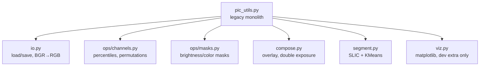

# Legacy Modernization — Handoff Plan

> **Status:** PROPOSED — handoff notes for the first modernization steps.
> Binding companion: `specs/stack.md` (decided stack). This document covers
> **only** the core library (`pic_utils.py`); GUI/pipeline work comes later
> and must not start before this plan's exit criteria are met.

## 0. Current state (verified by full read of `pic_utils.py`, 541 lines)

Single module, 6 public functions, no package metadata, no tests, no CLI.
Three concerns are tangled: pixel operations, compositing (PIL), and ML
segmentation (sklearn/skimage), plus matplotlib plotting embedded in library
code. Examples folder holds ~125 MB of PNGs committed to git.

| Function | Input | Output | Main problem |
|---|---|---|---|
| `find_channel_percentiles` | array | dict | Mostly fine; keep |
| `visualize_permutations` | BGR array | list[dict] | Computes **and** plots (`plt.show`) |
| `overlay_images` | array/PIL | RGBA array | `white_to_transparent` hits the **background**, not the overlay (contradicts docstring); RGB/BGR ambiguity |
| `double_exposure` | array/PIL | RGB uint8 | Crashes on size mismatch when `resize_to_match=False` |
| `conditional_overlay` | array/PIL | RGBA array | Channel 0 assumed R; wrong if fed cv2-BGR input |
| `segment_and_color` | **path** | (img, masks, subimages) | Python loop over superpixels; N full-image copies; `np.random` ignores `random_state`; `% modules` can divide by zero; `plt.show` |

## 1. Cross-cutting defects to fix (with evidence)

1. **No canonical image format.** cv2 yields BGR, PIL expects RGB; functions
   mix both. `overlay_images`/`conditional_overlay` call `Image.fromarray`
   without conversion; `conditional_overlay` indexes `[..., 0]` as "R".
   → Silent color corruption whenever a cv2-loaded image is passed.
2. **Mixed I/O contracts.** `segment_and_color` takes a path; all others take
   arrays. Some return RGBA, some RGB, some float, some uint8.
3. **Side effects in library code.** `plt.show()` in `visualize_permutations`
   and `segment_and_color` makes them unusable in an app/batch context.
4. **Unseeded randomness.** `segment_and_color(apply_modular_effect=True)`
   uses `np.random.randint` despite accepting `random_state`.
5. **Unvectorized hot loops.** Per-superpixel mean via Python loop over
   `np.unique(segments)`; per-cluster `image_rgb.copy()` (N × H×W×3 memory).
6. **Latent crash paths.** `double_exposure` broadcast error on mismatched
   sizes; `% modules[c]` when a random module is 0.
7. **Repo hygiene.** ~125 MB example PNGs in git; no `pyproject.toml`, no
   tests, no CI, no lockfile.

## 2. Target module layout (first cut)

Rules:
- `io.py` is the **only** place that knows file formats and channel order.
- `ops/`, `compose.py`, `segment.py`: numpy arrays in → numpy arrays out.
  No paths, no plotting, no `print`.
- `viz.py` is dev-only and never imported by the app runtime.

## 3. Decisions required before coding (architecture-adjacent)

These are small but blocking; resolve in the architecture doc or as a
one-line decision record:

1. **Canonical dtype/range**: recommend `uint8` at boundaries, `float32`
   in `[0,1]` inside math-heavy ops (explicit conversion helpers).
2. **Canonical channel order**: RGB everywhere internal; BGR only inside
   `io.py` when talking to cv2.
3. **Alpha policy**: RGBA only at compositing boundaries; no premultiplied
   alpha in v1.
4. **Docstring language**: recommend English for all new code (current code
   is mostly Spanish); legacy docstrings translated as functions are touched.
5. **Behavior compatibility**: bug fixes (items 1, 3, 4, 6 above) are
   intentional and must be called out in the changelog, not silently shipped.

## 4. Ordered work plan

Each step is independently reviewable; do not merge steps.

**Step 1 — Freeze & hygiene.**
Tag the legacy commit. Move `examples/*.png` out of git history going forward
(Git LFS or external hosting). No code changes.

**Step 2 — Packaging skeleton.**
`pyproject.toml` (per `specs/stack.md`), `src/pic_utils/`, uv lockfile,
ruff/pytest/mypy configured. `pic_utils.py` moves in unchanged as
`src/pic_utils/legacy.py` with a deprecation note. Tests directory with
fixtures generated in code (small synthetic arrays; no binary fixtures).

**Step 3 — Canonical I/O.**
Implement `io.load()` / `io.save()` with explicit RGB conversion and dtype
normalization. Add round-trip tests (PNG, JPEG; alpha and grayscale inputs).

**Step 4 — Split & purify.**
Move each function to its target module; change signatures to arrays-in/
arrays-out; remove `plt.show()` and path parameters (`segment_and_color`
takes an array). Keep a thin `legacy.py` re-export layer temporarily so
existing experiments keep running; delete it once ported.

**Step 5 — Fix known defects.**
`white_to_transparent` applies to the overlay; seed all randomness from
`random_state`; guard `modules == 0`; explicit error on size mismatch in
`double_exposure`; document BGR/RGB boundary in `io.py`.

**Step 6 — Vectorize `segment_and_color`.**
Superpixel means via `np.bincount` over labels (no Python loop); avoid
per-cluster full-image copies (compute masks lazily / on demand); keep
MiniBatchKMeans on Lab pixels. Target: no Python-level loop over pixels or
superpixels.

**Step 7 — Test coverage of the public surface.**
Deterministic ops: golden-array tests on synthetic images. Stochastic ops:
fixed-seed reproducibility tests. Mask functions: boundary cases (empty
mask, full mask, single-channel ranges).

## 5. Exit criteria for this modernization phase

- `uv run pytest` green; `ruff` clean; `mypy` clean on new code.
- Zero `plt.show`, zero file paths, zero BGR assumptions outside `io.py`.
- All six legacy behaviors available through the new public API.
- `legacy.py` deleted (no permanent shim).
- Changelog documents every intentional behavior change.

## 6. Explicit non-goals

- No GUI, no pipeline/spec-JSON work (later phases).
- No GPU work.
- No new image effects; this phase is behavior-preserving except the listed
  bug fixes.
- No performance micro-optimization beyond Step 6's vectorization.
